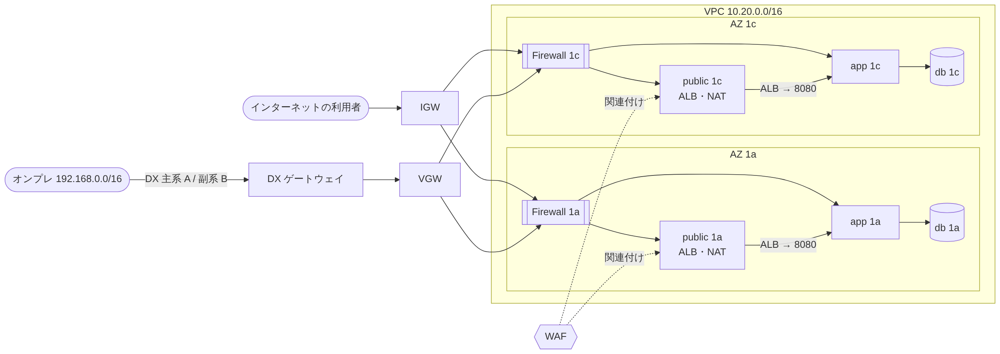

# AWS ネットワーク設計書のサンプル(VPC・Direct Connect・ALB・NAT・WAF・Network Firewall)

エンジニアが書く「基本設計書」と「パラメータシート」のサンプルです(Kiro の資料 `docs/ai-driven-dev-kiro.pptx` の 16・17 枚目。Claude がこのラボで作った見本で、Kiro が実際に出すものとは形が違うことがあります)。会社名・ドメイン・IP・ASN はすべて架空(文書用の範囲)で、
本物の AWS には入れていません。

| ファイル | 中身 |
|---|---|
| [`design-samples/aws-network/basic-design.md`](design-samples/aws-network/basic-design.md) | 基本設計書(目的と範囲・前提・構成図・通信の流れ・各サービスの設計・可用性・運用監視・試験・未決事項・改版履歴) |
| [`design-samples/aws-network/parameter-sheet.md`](design-samples/aws-network/parameter-sheet.md) | パラメータシート(Markdown) |
| `design-samples/aws-network/parameter-sheet.xlsx` | パラメータシート(Excel、11 シート、印刷は横向き・幅 1 ページ) |
| [`design-samples/aws-network/check.md`](design-samples/aws-network/check.md) | 値の矛盾チェックの結果と、ルートの行き・戻りの計算 |
| `design-samples/aws-network/diagram.png` | 構成図(設計書の Mermaid を描いたもの) |



## 構成の要点

- 東京リージョン、2 つの AZ(1a・1c)。サブネットは public(ALB・NAT)/ firewall(/28)/ app / db を AZ ごとに。
- インターネットの出入りとオンプレの出入りを、両方とも AWS Network Firewall で検査する。
  - IGW と VGW にエッジのルートテーブルを関連付け、入ってくる通信を Firewall へ向ける。
  - **行きと帰りが同じ AZ の Firewall を通る**ようにルートを組む(ステートフルの検査は、片方向しか見えないと通信を切る)。
- Direct Connect は 2 つのロケーションに 1 本ずつ。AWS → オンプレの向きは、BGP コミュニティで主系を選ぶ(主系 7224:7300 / 副系 7224:7100)。
- ALB は HTTPS(TLS 1.3 / 1.2 のポリシー)、80 番は 443 へ転送。WAF はマネージドルール 4 つ + 回数制限で、最初は Count から始める。
- NAT ゲートウェイは AZ ごとに 1 つ。アプリから外へ出る通信は、Firewall のドメインの一覧(許可するものだけ)で絞る。
- VPC の中どうし(ALB → アプリ、アプリ → DB)は Firewall を通らない。SG で絞る。

## 値を 1 か所に置き、矛盾を機械的に確かめる

設計書とパラメータシートは、どちらも `tools/design_docs/aws_network_sample.py` の `DESIGN` から作ります。
資料で「作るより確かめる方が大変」と書いたとおり、ルートテーブルの組み合わせは人の目では抜けやすいので、次の点を計算で確かめます。

```
$ python3 tools/design_docs/aws_network_sample.py --out docs/design-samples/aws-network
OK  サブネットが VPC の中にある
OK  サブネットが重ならない
OK  オンプレの帯と VPC が重ならない
OK  ルートの行き先がすべて定義済み
OK  同じ AZ の Firewall / NAT を使う
OK  外へ出る経路は必ず Firewall を通る
OK  行きと帰りが同じ Firewall エンドポイントを通る
OK  SG の参照先がある
OK  WAF の WCU の合計 1127 が 1500 以内(各値は要確認)
OK  DX が 2 つのロケーションに分かれている
OK  DX の主系と副系でコミュニティが違う(7224:7300 / 7224:7100)
OK  Firewall の HOME_NET に VPC とオンプレが入る
Excel: あり / 出力: docs/design-samples/aws-network
```

**チェックで実際に見つかった抜け(2 件)**:

1. 初版では、VGW のエッジのルートテーブルに public のサブネットを書いていなかった。
   public → オンプレの行きは Firewall を通るのに、戻りが Firewall を飛ばして直接届き、行きと帰りがずれていた
   (`戻り: vgw → local(違う)`)。VGW のエッジに `10.20.0.0/24 → fw-1a`・`10.20.1.0/24 → fw-1c` を足して直した。
2. パラメータシートに Network Firewall のポリシー自体の設定(評価の順・既定アクション・HOME_NET)が無かった。
   設計書とパラメータシートの値を突き合わせるテストで見つけ、「NFWポリシー」のシートを足した。

テストは `tests/test_aws_network_design_sample.py`。チェックがすべて OK であることに加え、わざと値を壊して
(エッジの行を消す・アプリから IGW へ直接出す・別 AZ の Firewall を使う・サブネットを重ねる)チェックが NG になることも確かめています。

## 確かめていないこと・要確認

- 本物の AWS には作っていない。Terraform にもしていない(このサンドボックスは Terraform の取得先に届かない)。
- WAF の各マネージドルールの WCU(25・700・200・200)は記憶による値で、公式の一覧では確かめられなかった。
  導入時に CheckCapacity かコンソールで確かめる。
- Network Firewall は 2026-06 から、新しいポリシーの既定のアクションが「Application drop established(server-directed only)」に変わった。
  このサンプルは STRICT_ORDER の推奨どおり drop_established + alert_established を明示している。どちらにするかは未決事項に入れた。
- CloudWatch のメトリクス名は導入時に確かめる。

## 出典(2026-11-23 に検索で確認)

- [AWS Direct Connect routing policies and BGP communities](https://docs.aws.amazon.com/directconnect/latest/UserGuide/routing-and-bgp.html)(7224:7100 / 7200 / 7300 の local preference)
- [How do I set an Active/Passive AWS Direct Connect connection](https://aws.amazon.com/premiumsupport/knowledge-center/active-passive-direct-connect/)
- [Troubleshooting rules in AWS Network Firewall](https://docs.aws.amazon.com/network-firewall/latest/developerguide/troubleshooting-rules.html)(STRICT_ORDER では Drop established と Alert established)
- [StatefulEngineOptions](https://docs.aws.amazon.com/network-firewall/latest/APIReference/API_StatefulEngineOptions.html)(STRICT_ORDER が推奨、既定は DEFAULT_ACTION_ORDER)
- [AWS Network Firewall updates default drop action](https://aws.amazon.com/about-aws/whats-new/2026/06/aws-network-firewall-updates-default-drop-action)
- [AWS WAF web ACL capacity units](https://docs.aws.amazon.com/waf/latest/developerguide/aws-waf-capacity-units.html)
