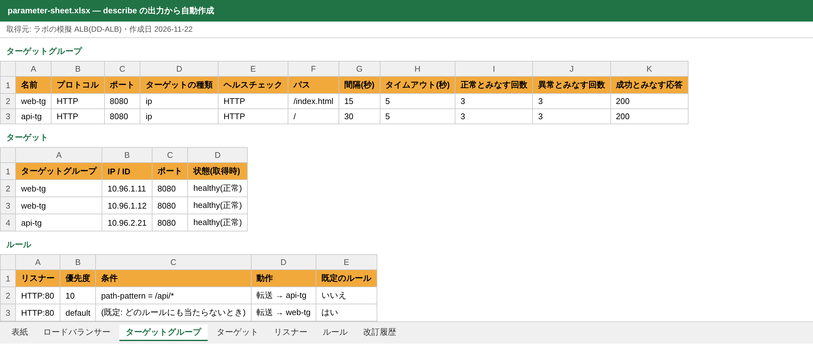

# ALB の「現物」から基本設計書とパラメータシートを作る(ラボで試した記録)

資料「AI ドリブン開発の裏側」の「設計書を会社の形に寄せるには」で挙げた「値は現物から起こす」を、ラボの ALB 模擬装置で
実際にやった記録です(2026-11-22)。

## やったこと

1. ラボに ALB の模擬装置(`DD-ALB`、名前 `shop-alb`)と、Web サーバー役の PC を 3 台(`python3 -m http.server 8080`)用意した。
2. aws-cli と同じ構文で ALB を組んだ:
   ```
   aws elbv2 create-load-balancer --name shop-alb --type application --scheme internet-facing
   aws elbv2 create-target-group --name web-tg --protocol HTTP --port 8080 --health-check-protocol HTTP --health-check-path /index.html --health-check-interval-seconds 15
   aws elbv2 create-target-group --name api-tg --protocol HTTP --port 8080 --health-check-protocol HTTP --health-check-path / --health-check-interval-seconds 30
   aws elbv2 register-targets --target-group-arn web-tg --targets Id=10.96.1.11,Port=8080 Id=10.96.1.12,Port=8080
   aws elbv2 register-targets --target-group-arn api-tg --targets Id=10.96.2.21,Port=8080
   aws elbv2 create-listener --load-balancer-arn shop-alb --protocol HTTP --port 80 --default-actions Type=forward,TargetGroupArn=web-tg
   aws elbv2 create-rule --listener-arn <リスナーの ARN> --priority 10 --conditions Field=path-pattern,Values=/api/* --actions Type=forward,TargetGroupArn=api-tg
   ```
3. 本物の HTTP で、設計どおりに振り分けることを確かめた:
   ```
   /index.html -> dd-web1
   /index.html -> dd-web2
   /api/items  -> dd-api1
   ```
4. `tools/design_docs/alb_design_docs.py` で、describe の出力から設計書を作った:
   ```bash
   python3 tools/design_docs/alb_design_docs.py --lab http://127.0.0.1:8000 --device DD-ALB --out docs/design-samples/shop-alb
   ```

## できたもの(`docs/design-samples/shop-alb/`)

| ファイル | 中身 |
|---|---|
| `basic-design.md` | 基本設計書の下書き。表紙の表(版・作成日・作成方法・状態「未レビュー」)、構成図(Mermaid)、方針(負荷分散・振り分けのルール・ヘルスチェック)は値から組み立て、目的と範囲・非機能要件・確認事項は「人が書く」欄 |
| `parameter-sheet.xlsx` | パラメータシート。表紙・ロードバランサー・ターゲットグループ・ターゲット・リスナー・ルール・改訂履歴のシート |
| `parameter-sheet.md` | 同じ内容の Markdown 版 |
| `describe.json` | 元にした describe の出力そのもの(いつ・どこから取ったか付き) |



## 作りの考え方

- **値は AI に考えさせない**: 設定値はすべて `describe-load-balancers`・`describe-target-groups`・`describe-target-health`・
  `describe-listeners`・`describe-rules` の出力から機械的に転記する。設計書と実物が食い違わない。
- **呼ぶのは describe だけ**: 読み取りの権限で動く。AWS に変更を加えない。
- **同じ命令を、ラボにも本物の AWS にも投げられる**: `--lab`(このエミュレータの `/api/cli`)と `--aws`(手元の aws-cli と
  認証情報、`--profile`・`--region`)。模擬装置は aws-cli と同じ形の JSON を返すので、作る部分は共通。
- **人が書く部分ははっきり分ける**: 目的・範囲・非機能要件・確認事項は値からは決まらない。Kiro などの AI に下書きさせるならこの部分で、
  そのときも会社の章立てを Steering に入れておく。

## 試していないこと・気をつけること

- **本物の AWS での `--aws` は試していない**(この作業環境から AWS には届かない)。describe の出力の形は aws-cli と同じにしてあるが、
  実際の値(複数の AZ・セキュリティグループなど)は今の表には出していない。必要なら項目を足す。
- ラボの ALB は、どれも既定の VIP が `172.31.0.10:80` で同じ。前回のラボの保存設定(`saved_config.json`)に別の ALB が残っていると、
  そちらが先に VIP を取り、新しい ALB への通信が 503 になる(今回もそれで一度つまずいた。保存設定を外して作り直した)。
- Excel の出力には openpyxl が要る(無ければ Markdown だけ作る)。
