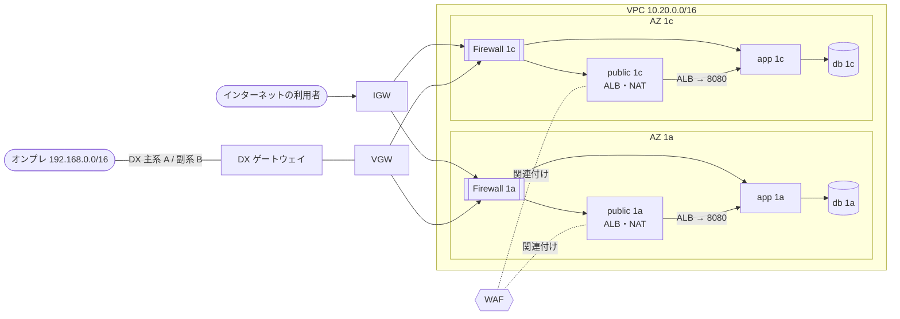

# サンプル商事 EC サイト 本番環境 AWS ネットワーク 基本設計書

> **サンプルです。** 会社名・ドメイン・IP アドレス・ASN はすべて架空(文書用の範囲)。本物の AWS には入れていません。
> 値は `tools/design_docs/aws_network_sample.py` の 1 か所から作り、パラメータシートと同じです。

| 項目 | 内容 |
|---|---|
| 版 | 0.1(サンプル) |
| 作成 | (作成者) |
| 確認 | (確認者) |
| 承認 | (承認者) |
| 対象 | VPC・Direct Connect・ALB・NAT ゲートウェイ・WAF・Network Firewall |

## 1. 目的と範囲

EC サイトの本番環境を AWS に置き、インターネットの利用者からは ALB 経由で、社内(オンプレ)からは Direct Connect 経由で使えるようにする。インターネットとオンプレの両方の出入りを AWS Network Firewall で検査し、Web の攻撃は WAF で止める。

範囲外(別紙): DNS(Route 53)、サーバー・DB の設計、アカウント・IAM の設計、オンプレ側ルーターの設定。

## 2. 前提と制約

| 項目 | 内容 |
|---|---|
| リージョン | ap-northeast-1(東京) |
| AZ | ap-northeast-1a・ap-northeast-1c の 2 つ |
| VPC の帯 | 10.20.0.0/16(オンプレ 192.168.0.0/16 と重ならない) |
| オンプレの運用端末 | 192.168.100.0/24 |
| 名前の付け方 | <システム>-<環境>-<種類>-<AZ>(例: shop-prd-app-1a) |
| 作り方 | IaC(Terraform)で作り、変更も IaC から。コンソールで直接変えない |

## 3. 全体構成

- AZ ごとに Firewall・NAT を持ち、**行きと帰りが同じ AZ の Firewall を通る**ようにルートを組む(ステートフルの検査は、片方向しか見えないと通信を切る)。
- IGW と VGW にはエッジのルートテーブルを関連付け、入ってくる通信を Firewall へ向ける。
- VPC の中どうし(ALB → アプリ、アプリ → DB)は Firewall を通らない。SG で絞る。

## 4. 通信の流れ

| # | 通信 | 経路 |
|---|---|---|
| 1 | インターネット → Web | IGW → Firewall(AZ) → ALB(WAF) → アプリ。戻りは ALB → Firewall(同じ AZ) → IGW |
| 2 | アプリ → インターネット | アプリ → NAT(同じ AZ) → Firewall → IGW。Firewall から見える送信元は NAT の IP |
| 3 | オンプレ → アプリ | DX → VGW → Firewall(宛先の AZ) → アプリ。戻りはアプリ → Firewall(同じ AZ) → VGW |
| 4 | オンプレ → DB | Firewall で止める |
| 5 | アプリ → DB | VPC 内(SG で 5432 だけ許可) |

### ルートの確かめ(機械的に計算した結果)

| 送信元 | 宛先 | 行き | 戻り |
|---|---|---|---|
| shop-prd-pub-1a | インターネット | fw-1a → igw | 戻り: igw → fw-1a(同じ) |
| shop-prd-pub-1a | オンプレ | fw-1a → vgw | 戻り: vgw → fw-1a(同じ) |
| shop-prd-pub-1c | インターネット | fw-1c → igw | 戻り: igw → fw-1c(同じ) |
| shop-prd-pub-1c | オンプレ | fw-1c → vgw | 戻り: vgw → fw-1c(同じ) |
| shop-prd-app-1a | インターネット | nat-1a → fw-1a → igw | 戻り: igw → fw-1a(同じ) |
| shop-prd-app-1a | オンプレ | fw-1a → vgw | 戻り: vgw → fw-1a(同じ) |
| shop-prd-app-1c | インターネット | nat-1c → fw-1c → igw | 戻り: igw → fw-1c(同じ) |
| shop-prd-app-1c | オンプレ | fw-1c → vgw | 戻り: vgw → fw-1c(同じ) |
| shop-prd-db-1a | インターネット | None | 出られない(設計どおり: DB は外へ出さない) |
| shop-prd-db-1a | オンプレ | fw-1a → vgw | 戻り: vgw → fw-1a(同じ) |
| shop-prd-db-1c | インターネット | None | 出られない(設計どおり: DB は外へ出さない) |
| shop-prd-db-1c | オンプレ | fw-1c → vgw | 戻り: vgw → fw-1c(同じ) |

## 5. 方式設計

### 5.1 VPC・サブネット

| 名前 | 役割 | AZ | CIDR | 置くもの |
|---|---|---|---|---|
| shop-prd-pub-1a | public | 1a | 10.20.0.0/24 | ALB・NAT ゲートウェイ |
| shop-prd-pub-1c | public | 1c | 10.20.1.0/24 | ALB・NAT ゲートウェイ |
| shop-prd-fw-1a | firewall | 1a | 10.20.10.0/28 | Network Firewall エンドポイント |
| shop-prd-fw-1c | firewall | 1c | 10.20.10.16/28 | Network Firewall エンドポイント |
| shop-prd-app-1a | app | 1a | 10.20.20.0/24 | アプリケーションサーバー |
| shop-prd-app-1c | app | 1c | 10.20.21.0/24 | アプリケーションサーバー |
| shop-prd-db-1a | db | 1a | 10.20.30.0/24 | データベース |
| shop-prd-db-1c | db | 1c | 10.20.31.0/24 | データベース |

- DNS 解決・DNS ホスト名: 有効。フローログ: ALL を S3 へ(保存 1 年)。
- Firewall のサブネットは /28(エンドポイントだけを置く)。アプリ・DB にはパブリック IP を付けない。

### 5.2 ルートテーブル

| 名前 | 関連付け | 宛先 | 行き先 |
|---|---|---|---|
| shop-prd-rt-igw-edge | igw(エッジ関連付け) | 10.20.0.0/24 | Network Firewall エンドポイント(shop-prd-fw-1a) |
| shop-prd-rt-igw-edge | igw(エッジ関連付け) | 10.20.1.0/24 | Network Firewall エンドポイント(shop-prd-fw-1c) |
| shop-prd-rt-vgw-edge | vgw(エッジ関連付け) | 10.20.0.0/24 | Network Firewall エンドポイント(shop-prd-fw-1a) |
| shop-prd-rt-vgw-edge | vgw(エッジ関連付け) | 10.20.1.0/24 | Network Firewall エンドポイント(shop-prd-fw-1c) |
| shop-prd-rt-vgw-edge | vgw(エッジ関連付け) | 10.20.20.0/24 | Network Firewall エンドポイント(shop-prd-fw-1a) |
| shop-prd-rt-vgw-edge | vgw(エッジ関連付け) | 10.20.21.0/24 | Network Firewall エンドポイント(shop-prd-fw-1c) |
| shop-prd-rt-vgw-edge | vgw(エッジ関連付け) | 10.20.30.0/24 | Network Firewall エンドポイント(shop-prd-fw-1a) |
| shop-prd-rt-vgw-edge | vgw(エッジ関連付け) | 10.20.31.0/24 | Network Firewall エンドポイント(shop-prd-fw-1c) |
| shop-prd-rt-pub-1a | shop-prd-pub-1a | 0.0.0.0/0 | Network Firewall エンドポイント(shop-prd-fw-1a) |
| shop-prd-rt-pub-1c | shop-prd-pub-1c | 0.0.0.0/0 | Network Firewall エンドポイント(shop-prd-fw-1c) |
| shop-prd-rt-fw-1a | shop-prd-fw-1a | 0.0.0.0/0 | shop-prd-igw |
| shop-prd-rt-fw-1a | shop-prd-fw-1a | 192.168.0.0/16 | shop-prd-vgw |
| shop-prd-rt-fw-1c | shop-prd-fw-1c | 0.0.0.0/0 | shop-prd-igw |
| shop-prd-rt-fw-1c | shop-prd-fw-1c | 192.168.0.0/16 | shop-prd-vgw |
| shop-prd-rt-app-1a | shop-prd-app-1a | 0.0.0.0/0 | shop-prd-nat-1a(shop-prd-pub-1a、EIP) |
| shop-prd-rt-app-1a | shop-prd-app-1a | 192.168.0.0/16 | Network Firewall エンドポイント(shop-prd-fw-1a) |
| shop-prd-rt-app-1c | shop-prd-app-1c | 0.0.0.0/0 | shop-prd-nat-1c(shop-prd-pub-1c、EIP) |
| shop-prd-rt-app-1c | shop-prd-app-1c | 192.168.0.0/16 | Network Firewall エンドポイント(shop-prd-fw-1c) |
| shop-prd-rt-db-1a | shop-prd-db-1a | 192.168.0.0/16 | Network Firewall エンドポイント(shop-prd-fw-1a) |
| shop-prd-rt-db-1c | shop-prd-db-1c | 192.168.0.0/16 | Network Firewall エンドポイント(shop-prd-fw-1c) |

- VGW の経路伝播はどのテーブルでも使わない(伝播させると Firewall を飛ばしてしまう)。オンプレの帯は静的に書く。
- VGW のエッジには public のサブネットも書く。書かないと public → オンプレの戻りが Firewall を飛ばし、行きと帰りがずれて通信が切れる(初版はこれが漏れていて、値の矛盾チェックで見つかった)。

### 5.3 セキュリティグループ

| SG | 向き | プロトコル | ポート | 相手 | 目的 |
|---|---|---|---|---|---|
| shop-prd-sg-alb | in | tcp | 443 | 0.0.0.0/0 | HTTPS |
| shop-prd-sg-alb | in | tcp | 80 | 0.0.0.0/0 | HTTPS へ転送するため |
| shop-prd-sg-alb | out | tcp | 8080 | shop-prd-sg-app | ターゲットへ |
| shop-prd-sg-app | in | tcp | 8080 | shop-prd-sg-alb | ALB から |
| shop-prd-sg-app | in | tcp | 22 | 192.168.100.0/24 | 運用端末から |
| shop-prd-sg-app | out | tcp | 5432 | shop-prd-sg-db | DB へ |
| shop-prd-sg-app | out | tcp | 443 | 0.0.0.0/0 | 外部 API・更新(Firewall で絞る) |
| shop-prd-sg-db | in | tcp | 5432 | shop-prd-sg-app | アプリから |

### 5.4 Direct Connect

| 項目 | 主系 | 副系 |
|---|---|---|
| 接続 | shop-dxcon-a | shop-dxcon-b |
| ロケーション | DX ロケーション A(東京) | DX ロケーション B(大阪) |
| 帯域・種類 | 1Gbps・専用接続 | 1Gbps・専用接続 |
| VIF(プライベート) | shop-vif-a | shop-vif-b |
| VLAN | 101 | 102 |
| BGP(AWS 側 / オンプレ側) | 169.254.10.1/30 / 169.254.10.2/30 | 169.254.20.1/30 / 169.254.20.2/30 |
| オンプレの ASN | 65010 | 65010 |
| 付けるコミュニティ | 7224:7300(高) | 7224:7100(低) |

- DX ゲートウェイ: shop-dxgw(Amazon 側 ASN 64512)、許可するプレフィックス 10.20.0.0/16。DX ゲートウェイに関連付け。VPC へ VGW 経由で入る通信はエッジのルートテーブルで Firewall へ。
- 2 つのロケーションに 1 本ずつ(片方のロケーションが止まっても続く形)。
- AWS → オンプレの向きは、オンプレから広告する経路に付けるコミュニティで主系を選ぶ(7224:7300 が優先)。オンプレ → AWS の向きは、オンプレのルーターの local preference で主系を選ぶ。
- MTU 1500、BFD はオンプレのルーター側で有効(300ms × 3)、MD5 の鍵は別管理(Secrets Manager。本書に値を書かない)。
- 広告する経路: オンプレ → AWS 192.168.0.0/16(プライベート VIF は 100 経路まで。超えると BGP が止まる)、AWS → オンプレ 10.20.0.0/16。

### 5.5 ALB

| 項目 | 値 |
|---|---|
| 名前 | shop-prd-alb |
| 種類 | internet-facing |
| サブネット | shop-prd-pub-1a・shop-prd-pub-1c |
| SG | shop-prd-sg-alb |

| リスナー | ポート | 動作 | TLS |
|---|---|---|---|
| HTTP | 80 | HTTPS:443 へ 301 で転送 | - |
| HTTPS | 443 | shop-prd-tg-app へ転送 | ELBSecurityPolicy-TLS13-1-2-2021-06 / ACM 証明書 *.shop.example.jp |

| 属性 | 値 |
|---|---|
| idle_timeout.timeout_seconds | 60 |
| deletion_protection.enabled | true |
| routing.http.drop_invalid_header_fields.enabled | true |
| routing.http.xff_header_processing.mode | append |
| access_logs.s3.enabled | true(shop-prd-alb-logs) |

ターゲットグループ shop-prd-tg-app: HTTP 8080、instance、登録解除の待ち 60 秒、スティッキー 無効。

| ヘルスチェック | 値 |
|---|---|
| path | /healthz |
| matcher | 200 |
| interval | 30 秒 |
| timeout | 5 秒 |
| healthy_threshold | 5 |
| unhealthy_threshold | 2 |

### 5.6 NAT ゲートウェイ

| 名前 | サブネット | 種類 | EIP |
|---|---|---|---|
| shop-prd-nat-1a | shop-prd-pub-1a | パブリック | shop-prd-eip-nat-1a |
| shop-prd-nat-1c | shop-prd-pub-1c | パブリック | shop-prd-eip-nat-1c |

- AZ ごとに 1 つ(AZ をまたぐ通信の料金と、片方の AZ の障害の巻き込みを避ける)。
- 外の相手に許可してもらう送信元 IP は、この 2 つの EIP。

### 5.7 WAF

Web ACL shop-prd-webacl(REGIONAL(ALB に関連付け))、既定の動作は Allow。

| 優先度 | ルール | 中身 | 動作 | WCU(要確認) |
|---|---|---|---|---|
| 10 | AWSManagedRulesAmazonIpReputationList | 評判の悪い IP | 最初は Count → Block | 25 |
| 20 | AWSManagedRulesCommonRuleSet | 一般的な攻撃(OWASP 系) | 最初は Count → Block | 700 |
| 30 | AWSManagedRulesKnownBadInputsRuleSet | 既知の悪い入力 | 最初は Count → Block | 200 |
| 40 | AWSManagedRulesSQLiRuleSet | SQL インジェクション | 最初は Count → Block | 200 |
| 50 | shop-prd-rate-limit | 同じ IP から 5 分に 2,000 回を超えたら | Block | 2 |

- ログ: CloudWatch Logs(ロググループ名は aws-waf-logs- で始める: aws-waf-logs-shop-prd)。Authorization と Cookie は伏せる。
- マネージドルールは最初 Count で入れ、誤検知を確かめてから Block にする。

### 5.8 Network Firewall

| 項目 | 値 |
|---|---|
| ファイアウォール | shop-prd-nfw |
| ポリシー | shop-prd-nfw-policy |
| エンドポイントのサブネット | shop-prd-fw-1a・shop-prd-fw-1c |
| 評価の順 | STRICT_ORDER |
| ステートレスの既定 | aws:forward_to_sfe |
| ステートフルの既定 | aws:drop_established + aws:alert_established |
| HOME_NET | 10.20.0.0/16・192.168.0.0/16 |
| ログ | ALERT と FLOW を S3 へ(ALERT は CloudWatch Logs にも) |
| TLS 検査 | 使わない(必要になったら別途設計) |

**shop-prd-rg-5tuple**(優先度 100、ステートフル(5 つの組み合わせ))

| 動作 | プロトコル | 送信元 | 宛先 | ポート | 目的 |
|---|---|---|---|---|---|
| pass | TCP | ANY | 10.20.0.0/23 | 443 | インターネット → ALB(HTTPS) |
| pass | TCP | ANY | 10.20.0.0/23 | 80 | インターネット → ALB(HTTPS へ転送) |
| pass | TCP | 192.168.100.0/24 | 10.20.20.0/23 | 22 | 運用端末 → アプリ(SSH) |
| pass | TCP | 192.168.0.0/16 | 10.20.20.0/23 | 443 | オンプレ → アプリ(社内向け API) |
| drop | IP | 192.168.0.0/16 | 10.20.30.0/23 | ANY | オンプレ → DB は止める(ログに残すため明示) |

**shop-prd-rg-egress-domains**(優先度 200、ドメインの一覧(ALLOWLIST、TLS_SNI と HTTP_HOST))

| 動作 | プロトコル | 送信元 | 宛先 | ポート | 目的 |
|---|---|---|---|---|---|
| pass | TLS/HTTP | 10.20.0.0/23(NAT) | .amazonaws.com | 443 | AWS の API |
| pass | TLS/HTTP | 10.20.0.0/23(NAT) | api.payment.example.com | 443 | 決済サービス(架空) |
| pass | TLS/HTTP | 10.20.0.0/23(NAT) | (OS 更新の配布元: 要決定) | 443 | OS の更新 |

- アプリから外へ出る通信は NAT を通った後に検査するので、Firewall からは NAT の IP しか見えない(どのアプリかは VPC フローログで見る)。
- 一覧に無い通信は drop_established で止まり、alert_established でログに残る。

## 6. 可用性

| 起きること | 動き | 対処・備え |
|---|---|---|
| AZ 1a の障害 | ALB は 1c へ。1c の NAT・Firewall で外へ出る(AZ ごとに独立) | なし(1c の容量で足りること) |
| Firewall エンドポイント 1a の障害 | 1a の通信が止まる(1c へは自動で寄らない) | ルートを 1c へ向け直す手順を運用手順書に用意 |
| NAT ゲートウェイ 1a の障害 | 1a のアプリから外へ出られない | ルートを nat-1c へ向け直す(AZ をまたぐ料金に注意) |
| DX 主系(A)の断 | BGP で副系(B)へ切り替わる | BFD で数秒以内を目標。切り替わりの時間は試験で測る |
| DX 両系の断 | オンプレとの通信が止まる | Site-to-Site VPN の予備は未決事項 |
| アプリ 1 台の障害 | ヘルスチェックで外れ、残りへ | なし |

## 7. 運用・監視

| 対象 | メトリクス | しきい値の考え方 |
|---|---|---|
| Direct Connect | ConnectionState・VirtualInterfaceBpsEgress/Ingress | 接続の断・帯域の 80% |
| ALB | UnHealthyHostCount・HTTPCode_ELB_5XX_Count・TargetResponseTime | 1 台以上の異常・5xx の急増・応答の遅れ |
| NAT ゲートウェイ | ErrorPortAllocation・PacketsDropCount | 0 を超えたら |
| WAF | BlockedRequests・CountedRequests | 急増したら |
| Network Firewall | DroppedPackets・PassedPackets | 止めた数の急増 |

- ログの置き場所: VPC フローログ・ALB アクセスログ・Firewall のログは S3、WAF のログは CloudWatch Logs。
- メトリクス名は導入時に CloudWatch で確かめる。

## 8. 試験

| 試験 | やること | 期待する結果 | 確かめるもの |
|---|---|---|---|
| インターネット → ALB 443 | https://www.shop.example.jp/ | 200 が返る | ALB アクセスログ・NFW の FLOW |
| インターネット → ALB 80 | http://www.shop.example.jp/ | 301 で https へ | ALB アクセスログ |
| インターネット → アプリ直接 | アプリの IP へ 8080 | 届かない(パブリック IP なし) | - |
| WAF: SQL インジェクション | ?id=1' OR '1'='1 | Count 期間はログのみ、Block 後は 403 | WAF ログ |
| WAF: 回数制限 | 同じ IP から 5 分に 2,000 回超 | 403 | WAF ログ・BlockedRequests |
| アプリ → 許可ドメイン | curl https://(許可した宛先) | 通る(送信元は NAT の EIP) | NFW の FLOW |
| アプリ → 許可外ドメイン | curl https://www.example.org | 止まる | NFW の ALERT |
| 運用端末 → アプリ 22 | ssh(192.168.100.0/24 から) | 通る | NFW の FLOW・VPC フローログ |
| 一般端末 → アプリ 22 | ssh(192.168.1.0/24 から) | 止まる | NFW の ALERT |
| オンプレ → DB 5432 | psql | 止まる | NFW の ALERT |
| アプリ → DB 5432 | psql | 通る(VPC 内は SG で制御、NFW は通らない) | VPC フローログ |
| DX 主系の断 | 主系 VIF を止める | 副系で継続。切り替わりの時間を記録 | BGP の状態・ping の欠け |
| AZ 1a の停止を想定 | 1a のアプリを止める | ALB が 1c だけに送る | UnHealthyHostCount |

## 9. 未決事項

- OS 更新の配布元など、外へ出てよい宛先の一覧(業務部門と決める)
- DX 両系断のときの予備(Site-to-Site VPN を張るか)
- Network Firewall の既定アクション: 2026-06 から新しいポリシーの既定は「Application drop established(server-directed only)」。本書は drop_established + alert_established を明示する(STRICT_ORDER の推奨)。どちらにするかを確定する
- WAF の各マネージドルールの WCU と料金(導入時に CheckCapacity で確認。1,500 を超えると追加料金がかかる場合がある)
- WAF を Count から Block へ切り替える日(誤検知の確認期間)
- DNS(Route 53 Resolver のインバウンド / アウトバウンド エンドポイント)は別紙
- VPC エンドポイント(S3 のゲートウェイ型、SSM などのインタフェース型)で NAT を通さない通信を増やすか

## 10. 値の矛盾チェック

| チェック | 結果 | 詳しく |
|---|---|---|
| サブネットが VPC の中にある | OK |  |
| サブネットが重ならない | OK |  |
| オンプレの帯と VPC が重ならない | OK |  |
| ルートの行き先がすべて定義済み | OK |  |
| 同じ AZ の Firewall / NAT を使う | OK |  |
| 外へ出る経路は必ず Firewall を通る | OK |  |
| 行きと帰りが同じ Firewall エンドポイントを通る | OK |  |
| SG の参照先がある | OK |  |
| WAF の WCU の合計 1127 が 1500 以内(各値は要確認) | OK |  |
| DX が 2 つのロケーションに分かれている | OK |  |
| DX の主系と副系でコミュニティが違う(7224:7300 / 7224:7100) | OK |  |
| Firewall の HOME_NET に VPC とオンプレが入る | OK |  |

## 改版履歴

| 版 | 日付 | 内容 | 作成 |
|---|---|---|---|
| 0.1 | (日付) | 初版(サンプル) | (作成者) |
