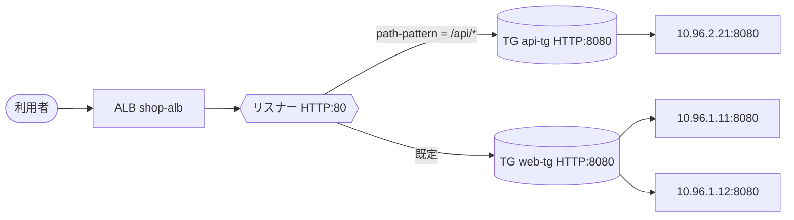

# 基本設計書(下書き): shop-alb

| 項目 | 内容 |
|---|---|
| 版 | 0.1(下書き) |
| 作成日 | 2026-11-22 |
| 作成方法 | `tools/design_docs/alb_design_docs.py` が describe の出力から自動で作成(ラボの模擬 ALB(DD-ALB)) |
| 状態 | **未レビュー**(人の確認と承認が要る) |

> この下書きの値はすべて describe の出力から機械的に起こしています。目的・範囲・非機能要件など、
> 値からは決まらない部分は「人が書く」としてあります。

## 1. 目的と範囲(人が書く)

- 目的:
- 対象の範囲 / 範囲外:
- 関係者:

## 2. 構成

## 3. 方針

### 3.1 負荷分散
- リスナーで受けた要求を、ルールの優先度の順に条件と照らし、当たったターゲットグループへ転送する。
- ターゲットグループの中では、正常なターゲットへ順番に振り分ける。

### 3.2 振り分けのルール
- path-pattern = /api/* → 転送 → api-tg(優先度 10)
- (既定: どのルールにも当たらないとき) → 転送 → web-tg(優先度 default)

### 3.3 ヘルスチェック
- **web-tg**: HTTP で `/index.html` を 15 秒ごとに確認し、200 を返せば正常。3 回続けて失敗したら外し、3 回続けて成功したら戻す
- **api-tg**: HTTP で `/` を 30 秒ごとに確認し、200 を返せば正常。3 回続けて失敗したら外し、3 回続けて成功したら戻す

## 4. 非機能要件(人が書く)

- 性能(想定の同時接続数・応答時間):
- 可用性(冗長化・AZ):
- 運用(監視・ログ・変更の手順):
- セキュリティ(公開範囲・証明書・セキュリティグループ):

## 5. パラメータ

詳しい値は別紙のパラメータシート(`parameter-sheet.xlsx` / `parameter-sheet.md`)を参照。

## 6. 確認事項(人が書く)

-
