# ニルヴァーナで gNMI の値を見る(gnmic → Prometheus 経由)

```
Catalyst ──gNMI(50052)──▶ gnmic ──:9804/metrics──▶ Prometheus(ヴァルハラ)──▶ ニルヴァーナ
```

ニルヴァーナ単体版(`cyber-view-standalone`)は gNMI を直接は話しません。
gnmic が gNMI で購読した値を Prometheus の形で公開し、ニルヴァーナはそれを Prometheus から読みます。

- 流量: `interfaces_interface_state_counters_in/out_octets` の rate
- リンクの断(POLL): `interfaces_interface_state_oper_status` の `oper_status` ラベル(UP / DOWN / LOWER_LAYER_DOWN)

snmp_exporter と並べて使えます(`flavor: both` では同じ装置・IF は SNMP を優先し、無いところを gNMI で埋めます)。

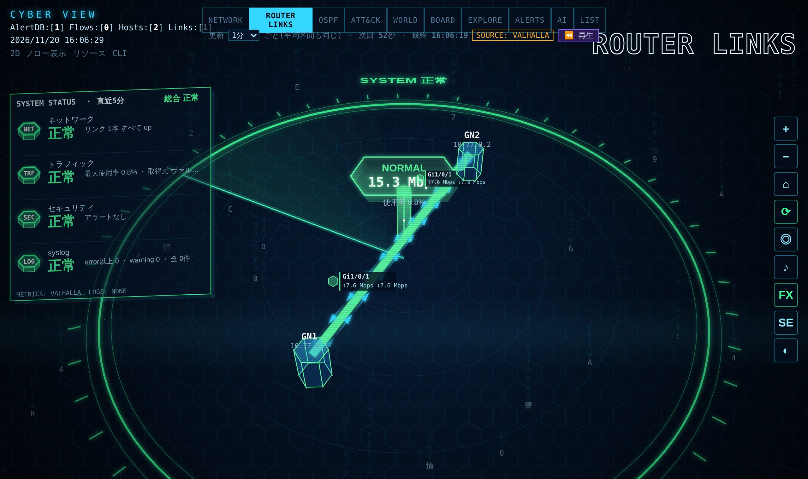

## コマンドを打たない方法: 設定画面(`setup_gui.py`)

装置の設定(下の 1)を済ませたら、Windows では `cyber-view-standalone\start-nirvana-gnmi.bat` をダブルクリックします。
ブラウザで設定画面(http://localhost:8092/)が開くので、**装置の IP とパスワードを入れて「開始」を押すだけ**です。

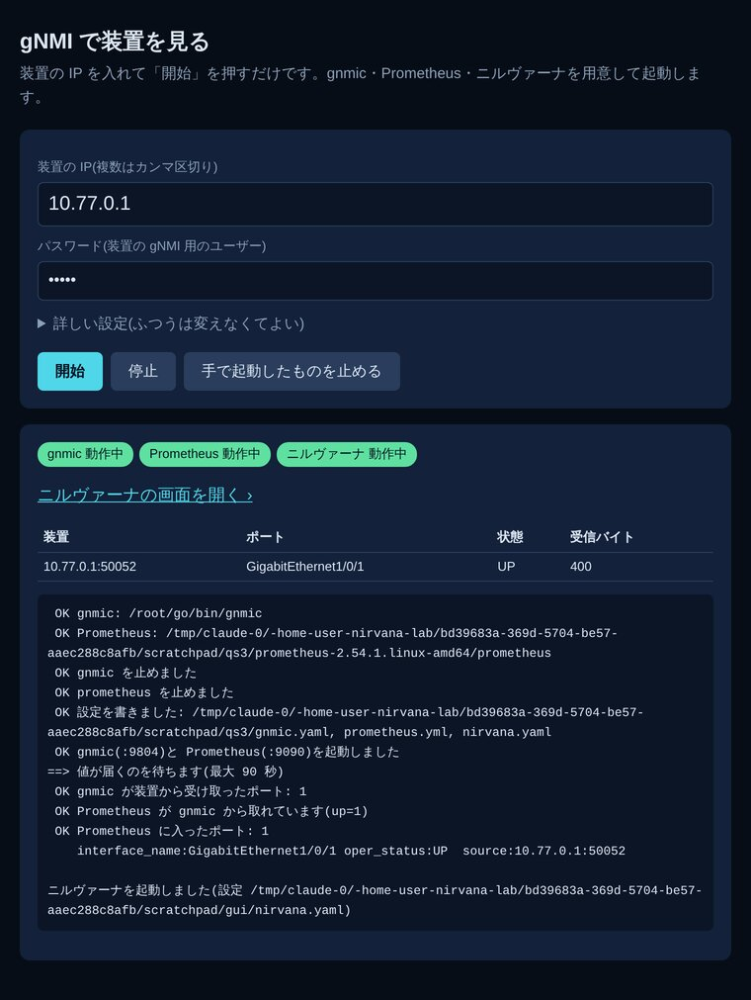

- 裏で `gnmi-quickstart.sh up` を動かします。Windows では WSL の中で動かし、gnmic・Prometheus の用意・設定・起動・確認まで行います。
- 続けてニルヴァーナを 8091 番で起動し、画面を開きます。選んだポートの先に「相手」を置いて、リンクとして表示します。
- うまくいかないときは、原因の目安を画面に出します(装置に届かない / パスワード / ポートの取り合い など)。
- PowerShell から起動するときは `.\start-nirvana-gnmi.bat`(先頭の `.\` が要る)。タイトル横の「版」で新しい画面か確かめられる。
  前の設定画面が残っていると二重起動になるので、そのときは黒いウィンドウを閉じる(残っていたら `taskkill /F /IM python.exe`)。

実機(WS-C3650-24TD、IOS XE 16.12.11)+ Windows 11 + WSL で「開始」を押した結果。gnmic・Prometheus・ニルヴァーナが上がり、
Gi1/0/1 が UP、受信バイトが届いている:


Windows で見つかって直した点: 標準入力に文字列で渡すと Python が改行を CRLF に戻し `set: pipefail\r` で止まる(バイト列で渡す)、
WSL が呼び出し元の Windows フォルダへ移ろうとして `chdir ... failed 5` を出す(`wsl --cd ~`)、Windows では SO_REUSEADDR で
同じポートに2つ目の設定画面が bind でき古い画面が答え続ける(`allow_reuse_address = False` と起動前の確認)。

SNMP も一緒に(版 3): 設定画面の「SNMP community」(既定 `public`、空にすると使わない)を入れて「開始」を押すと、
ニルヴァーナ(Windows の Python)が装置を SNMP で直接ポーリングする(`sources.snmp`: 経路表・CPU は60秒ごと、流量・IF 状態は10秒ごと)。
community は設定ファイルに書かず環境変数 `NIRVANA_SNMP_COMMUNITY` で渡す。開始時に sysName を聞いて確かめ、どの装置も応答しなければ
今回は SNMP を使わずに起動する(誤って「応答なし」を出さないため)。流量・IF 状態は gNMI(Prometheus)が優先で、SNMP は経路表・CPU と
gNMI に無い IF を補う。送信元は WSL ではなく Windows の PC の IP なので、装置の ACL はその IP を許可する:

```
ip access-list standard NIRVANA-SNMP
 permit <PC の IP>
snmp-server community public RO NIRVANA-SNMP
```

ラボの模擬 Catalyst(`snmp-server community public RO <ACL>`)で、設定画面の確認が OK(誤った community では NG と SNMP なしで起動)、
生成した設定でニルヴァーナを起動するとリンクの取得元 `snmp`・POLL `up` になることを確かめた。

版 4: SNMP で取れた CPU 使用率(Cisco の cpmCPUTotal5minRev、無ければ hrProcessorLoad。60秒ごと)を ROUTER LINKS の装置名・IP の下に
`CPU n%` で出す(50% 以上は橙、80% 以上は赤。`/api/traffic/hosts` の `cpu`。ラボ版も模擬 CPU を同じ欄に載せる)。設定画面が作る設定には
管理 IP を持つ IF(`mgmt`)を1つ足し、NETWORK 画面(IP アドレス空間)にも装置が置かれるようにした。OSPF 画面の「OSPF が動いている
ルータがありません」が他の画面へ切り替えても残っていたのも直した。


版 5: NetFlow も受ける(UDP 2055、v5 / v9 / IPFIX)。3650 の Flexible NetFlow は v5 を送れないので、`engine/flow_collector.py`
(= `cvs/flow_collector.py`)に v9(RFC 3954)と IPFIX(RFC 7011)のテンプレート読み取りを足した。テンプレートは送り元・ソースID・
テンプレートIDごとに覚え、届く前のデータは読めない(装置側で `template data timeout 60` にしておくと早く読めるようになる)。
本物の送り手 softflowd 1.1.0 で、同じ pcap から v5 / v9 / IPFIX を送り、3つとも同じフロー(192.168.1.10:50000→192.168.1.20:443、
3280 バイト・7 パケット、逆向き 5640 バイト・6 パケット)になること、設定画面が作る設定でニルヴァーナが v9 を受けて
`/api/traffic/flowmap` に通信の粒(via netflow9)が出ることを確かめた。Windows では初回に Python の受信を
ファイアウォールが聞いてくるので「プライベート ネットワーク」で許可する。
gNMI・SNMP・NetFlow をまとめた 3650 の設定サンプルは `cyber-view-standalone/catalyst-3650.example.txt`。

版 7: 受けたフローを保存し、送信元・宛先・通信量でまとめる(`cvs/flow_store.py`、`sources.flow.store`)。SQLite に1フロー1行
(時刻・送り元・送信元/宛先 IP・プロトコル・ポート・バイト・パケット・種類)を2秒ごとにまとめて書き、`keep_days`(既定30日)より古いものは消す。
ニルヴァーナの `/flows` で、期間(15分〜7日)・まとめ方(送信元→宛先 / 送信元ごと / 宛先ごと / サービスごと=小さいほうのポート)・IP の
絞り込みを選んで通信量の多い順に見られ、CSV で保存できる(API は `/api/flows/summary`・`/api/flows/export.csv`)。設定画面は
`~/.nirvana-gnmi/flows.db` に保存し、「フロー集計 ›」のリンクを出す。softflowd の v9 と IPFIX で同じ pcap を送り、まとめの数字
(例 192.168.1.163→192.168.1.1 が 40 パケット×1240 バイト×2 回 = 99,200 バイト)が合うことを確かめた。


版 8: OSPF 画面を SNMP の直接読み取りでも出す(`cvs/snmp_ospf.py`)。これまでの OSPF 画面はヴァルハラに貯めた OSPF-MIB
(snmp_exporter)を前提にしていたが、設定画面の構成のヴァルハラは gnmic の値しか持たないので「OSPF 未設定」と出ていた。
SNMP の community を入れて起動すると、30 秒ごとに ospfRouterId・ospfNbrTable・ospfIfAreaId・ipAddrTable を読み、隣接を
どの IF の先か・エリアと一緒に出す(取得元 `snmp`。読めていればヴァルハラより先に使う)。設定に無い相手は Router-ID の名前
(`RID 10.255.0.2` など)で1台として置き、相手側の状態は分からないので片側だけ出す。Cisco の OSPF-MIB はふつうグローバルの
プロセスだけを見せるので、VRF のプロセスは「相手」として見える。

PC(WSL)から実機と OSPF を張る試みの結果: WSL はミラーモードでも、ファイアウォール(Hyper-V・Windows とも)を開けても、
外から来る OSPF(IP プロトコル 89)を受けられない(マルチキャストもユニキャストの non-broadcast も `In` が 0 件、相手は INIT)。
代わりに 3650 1台の中で VRF を使い、折り返しケーブルで OSPF を張った(`catalyst-3650-vrf-ospf.example.txt`、FULL を実機で確認)。
仮想マシン・実機の Ubuntu で張るなら `ospf-peer.sh up`。

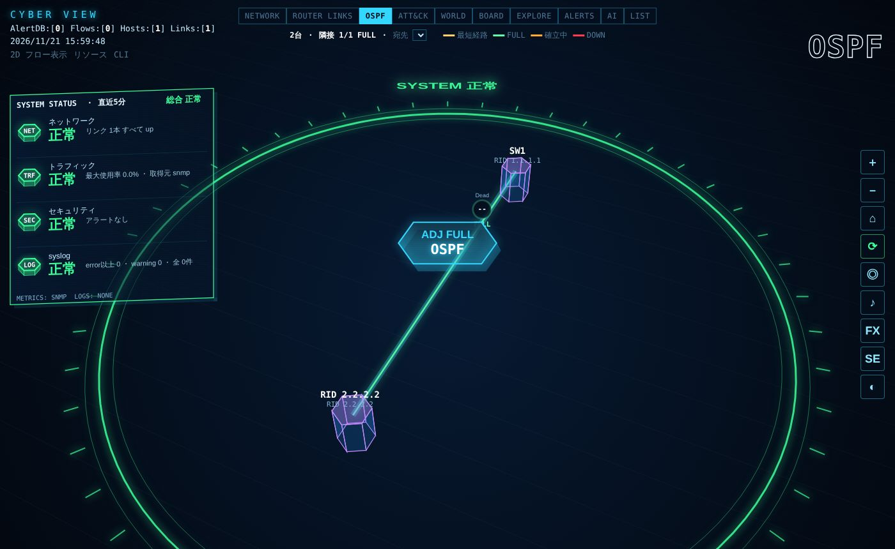

版 9: ヴァルハラにも SNMP を貯める(snmp_exporter 0.28.0 を `gnmi-quickstart.sh up --snmp-community <str>` で導入・起動、
:9116)。それまでの設定画面の構成ではヴァルハラが gnmic の値しか持たず、ROUTER LINKS の「再生」・使用率の予測・CPU の推移が
使えなかった。モジュールは `iac/cisco-traffic-monitoring/snmp_exporter/snmp.yml` の `cisco_if`(IF・CPU・ICMP・OSPF)をそのまま
`snmp-modules.yml` に書き、community は本人だけ読める `snmp-auth.yml`(`--config.file` を2つ渡す)。Prometheus に `snmp` ジョブ、
ニルヴァーナは `flavor: both` / `job: snmp`(同じポートは SNMP を優先し、無いところを gNMI で)。設定画面は SNMP community
(既定 public)をそのまま quickstart にも渡す(WSLENV)。SNMP が届かなくても gNMI の表示は続ける。ラボの模擬 Cisco と本物の
gnmic・Prometheus 2.54.1・snmp_exporter 0.28.0 で、`up` が「ヴァルハラが SNMP も取れています(IF 3 本・CPU 16%)」まで通り、
ニルヴァーナの `/api/valhalla/replay`・`/api/valhalla/forecast` が値を返すことを確かめた。

**実機の WS-C3650 でも確認した(2026-11-25、ユーザーの PC)**: 設定画面に SNMP community を入れて起動すると、ヴァルハラの
`:9090/targets` で `gnmic` と `snmp`(`module="cisco_if"`)が両方 UP。起動直後の 15 秒ほどは両方とも UNKNOWN(Last Scrape が
Never)で、失敗ではなく、まだ一度も取りに行っていないだけ。ニルヴァーナの ROUTER LINKS は SOURCE: VALHALLA・5 kbps・SW1 の
CPU 34%・「再生」ボタンが出た。紹介資料 v2 の 13 枚目「SNMP もヴァルハラに貯める(gNMI と両方)」。

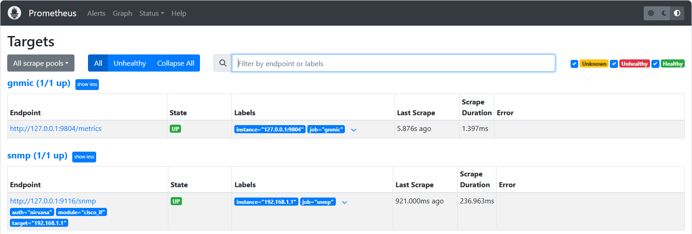

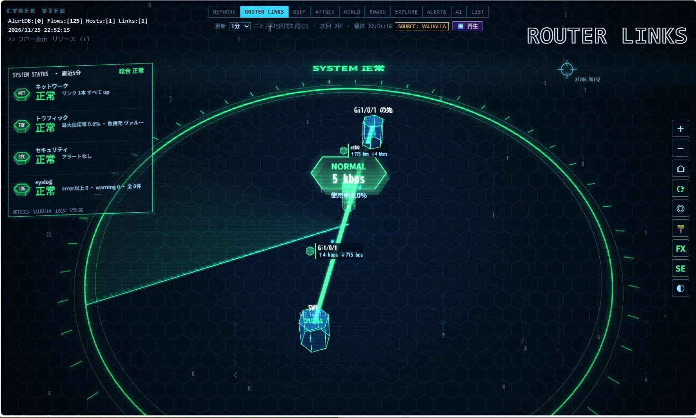

版 10: 「開始」を裏のスレッドで動かし、画面は `/api/result` を数秒ごとに取りに行く(長い POST をブラウザが切って
`ConnectionAbortedError` になり結果を失っていた。開き直しても続きが見える・二重に押しても1回だけ)。あわせて WSL ミラーモードで
空きポートへの接続確認が返ってこず `up` が止まる問題(`port_busy` を2秒で打ち切る)、Python 3.14 の SyntaxWarning、
uutils の `tail` が `-20` を受け付けない点を直した。**実機の Windows 11(Python 3.14)+ WSL(ミラーモード)+ WS-C3650 で、
版 10 の「開始」が最後まで通ることをユーザーが確認した。**

実機 WS-C3650 での結果(ユーザーの PC、版 10):

- OSPF: Gi1/0/23 と Gi1/0/24 を折り返しケーブルでつなぎ、Gi1/0/24 を VRF RED に入れて(`catalyst-3650-vrf-ospf.example.txt`)
  プロセス 1 と 2 が FULL。ニルヴァーナの OSPF 画面に SW1 と `RID 10.255.0.2` の `ADJ FULL`・`AREA 0`・Gi1/0/23 が出た
  (SNMP の直接読み取り)。

  

- NetFlow: Gi1/0/1 の input を Flexible NetFlow v9 で送り、`/flows` に 1 時間で 15.0 MB・12,290 パケット・1,149 フロー。
  99.9% が 192.168.1.100 → 192.168.1.1(gNMI・SNMP の監視そのもの)、残りは 239.255.255.250(SSDP)・224.0.0.5(OSPF)・
  ブロードキャスト。送信元が PC だけなのは input だけを見ているため(返りも見るなら output も付ける)。

  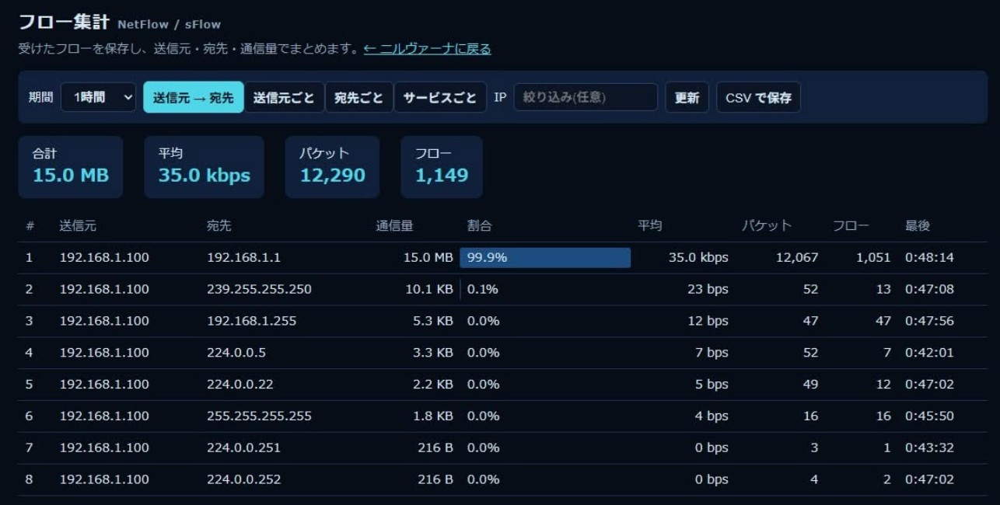

- ヴァルハラの SNMP(版 9): ROUTER LINKS の取得元が `VALHALLA`、9 kbps、CPU 54%(橙)、再生ボタン、予測・異常検知の
  「注 いつもと違う -3.2σ」(Catalyst を起動し直した直後でカウンタが 0 から数え直しになり、ふだんとの差が大きく出たもの)。

  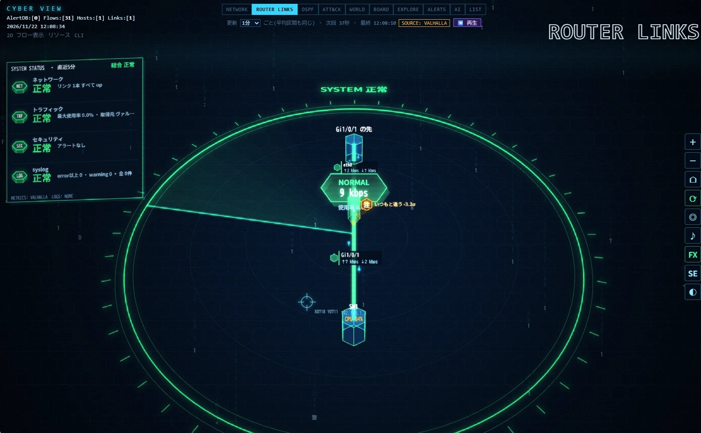

- 再起動後の NetFlow: Catalyst を起動し直したあとも、write memory した flow record・exporter・monitor でそのまま届いた。
  直近 1 時間は 26.9 KB・133 フロー、94.2% が 192.168.1.100 → 192.168.1.1(監視の通信だけ)。前の 15 MB は別の時間帯
  (期間を 24 時間・7 日にすると保存した過去の分も出る)。224.0.0.5(OSPF)が消えたのは WSL の FRR が止まったため。

  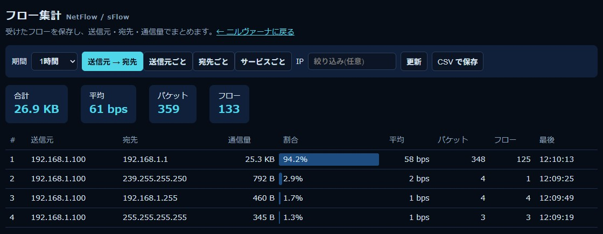

- WORLD(版 11): `nirvana.env` に Cloudflare のトークンを書き、IHR の期間の上限を直したあと、Cloudflare Radar・
  RIPE Atlas・DShield・IIJ Internet Health Report がすべて本物のデータで OK。

  

- syslog と AI ログ解析(版 12): Catalyst に `logging host 192.168.1.100`、Windows のファイアウォールで UDP 514 を許可
  (管理者の PowerShell)すると 6 件届き、syslog 観点が「異常」(%LINK-3-UPDOWN)。AI ログ解析は Groq を設定したが
  `HTTP Error 403: Forbidden` でルールに落ち、ルールで 3 件の所見(設定変更・インタフェース断)と確認コマンドを出した。
  403 は Groq の前段が Python 既定の User-Agent を断るためで、`engine/log_ai.py`(= `cvs/log_ai.py`)の `_post_json` に
  User-Agent を付けて直した(断られたときは本文もエラーに出す)。

  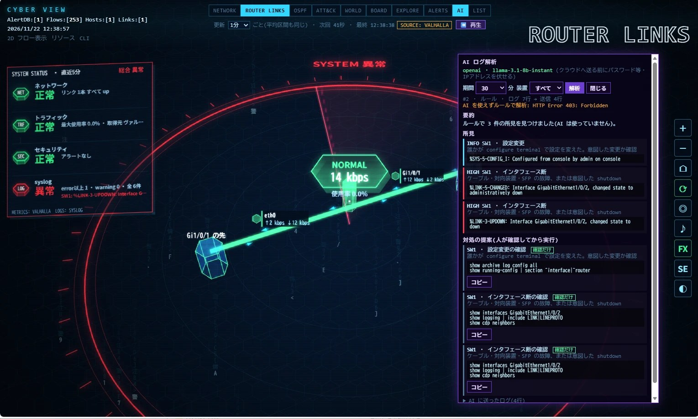

紹介資料 `docs/nirvana-introduction-v2.pptx` に、この6枚のスライド(当時の10〜15枚目。13枚目を足したあとは 10〜12・14〜16枚目)を足し、取り込み方の表の NetFlow を
「v5・v9・IPFIX」に直した。

版 11: 秘密の値(Cloudflare Radar の API トークンなど)は `%USERPROFILE%\.nirvana-gnmi\nirvana.env`(Linux は
`~/.nirvana-gnmi/nirvana.env`)に `KEY=VALUE` で書くと、設定画面がニルヴァーナを起動するときに環境変数として渡す
(`load_secrets`、`#` の行と空行は読まない、BOM 付きでも可)。リポジトリの外なので git に載らない。例:

```
CLOUDFLARE_API_TOKEN=<Cloudflare のトークン>
```

版 12: syslog も直接受ける(`cvs/syslog_receiver.py`、`sources.syslog.listen`、設定画面は UDP 514)。それまでの単体版は
Loki 経由でしかログを読めず、設定画面の構成では syslog 観点・AI ログ解析が空だった。送信元 IP(= `mgmt_ip`)か本文の
装置名で装置を決め、Loki の行と同じ `Analytics.record_log` に入れるので、syslog 観点・ログのプレート・フラップ・リンク断の
SYSLOG 経路・AI ログ解析がそのまま使える。RFC 3164 / 5424 の見出しと Cisco の通し番号・時刻は外し、重要度は Cisco の
`%FAC-<n>-` を優先して無ければ `<PRI>`。設定に無い装置からの行は数えるだけ(`unknown_syslog`)。本物の送り手
(util-linux の `logger` の RFC 3164 / 5424)と Cisco 形式の行で、`/api/traffic/logs` の取得元 `syslog`、syslog 観点「異常」、
リンクの SYSLOG 経路 `down` を確かめた。スイッチ側は `logging host <PC の IP>`(`catalyst-3650.example.txt` の 4)。

版 13: **Grafana と Loki も WSL で動かす**(設定画面の「Grafana と Loki も動かす」、既定で入。`gnmi-quickstart.sh up --loki`)。

```
Catalyst ─syslog UDP 514─▶ ニルヴァーナ(Windows)─写しを push─▶ Loki :3100(WSL)─┐
         ─gNMI─▶ gnmic ─┐                                                       ├─▶ Grafana :3000(WSL)
         ─SNMP─▶ snmp_exporter ─┴─▶ Prometheus(ヴァルハラ):9090(WSL)───────────┘
```

- syslog の受け口はニルヴァーナのまま(版 12 と同じ UDP 514)。受けた行の写しを `sources.syslog.loki_push` で Loki の
  `/loki/api/v1/push` に送る(`cvs/syslog_receiver.LokiPusher`、1 秒ごとにまとめて、ラベル `job="syslog"`・`device`・`host`・
  `severity`)。WSL を NAT のまま使っても、Windows から WSL の TCP には localhost で届くので、UDP を WSL へ通す必要が無い。
  Loki が止まっていても受け口は止めず、溜めて送り直す(最大 5000 行、`/api/health` の `loki_push`)。
  同じ Loki を `sources.loki` で読むと二重に数えるので、設定画面は `sources.loki` を書かない。
- quickstart は Loki 3.1.1(GitHub の配布物、zip は python3 で展開)と Grafana 11.3.0(dl.grafana.com、約 120 MB)を
  `~/nirvana-gnmi` に取ってきて起動する。Loki は 14 日で消す。Grafana はデータソース(ヴァルハラ / Loki)と
  ダッシュボード「Nirvana gNMI」を自動で入れ、ログインせずに見られる(閲覧のみ。編集は admin / admin)。
- ダッシュボード: gNMI の受信・送信 bps とポートの状態、SNMP の到達性・CPU・up のポートの流量、syslog の件数(重要度別)とログ。
- 開くところ: http://localhost:3000/d/nirvana-gnmi(設定画面の「Grafana ›」)。

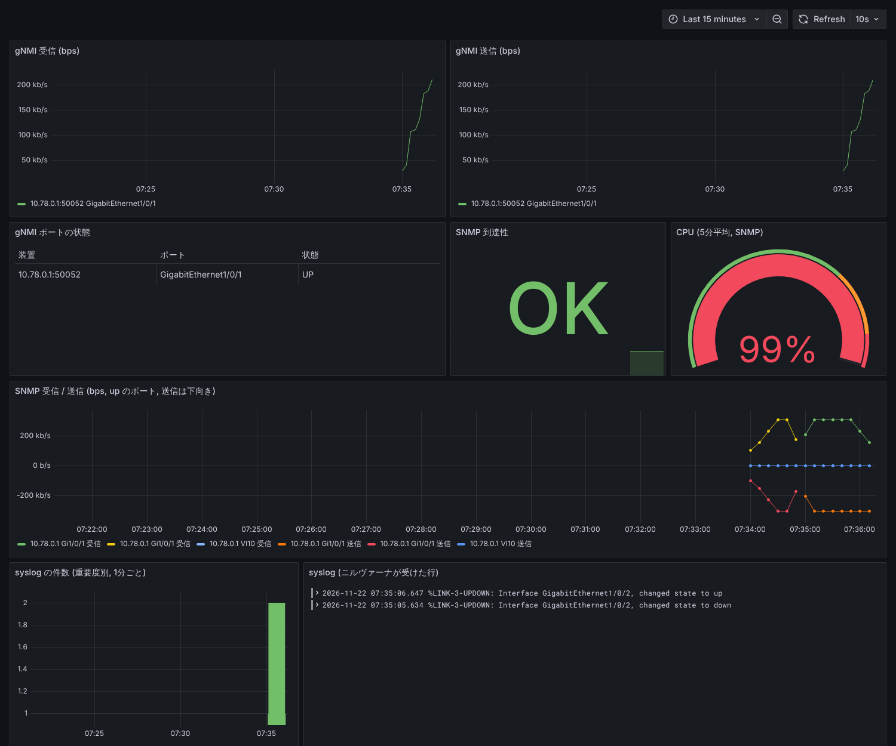

ラボの模擬 Catalyst(gNMI・SNMP・`logging host`)で、本物の gnmic・Prometheus 2.54.1・snmp_exporter 0.28.0・Loki 3.1.1・
Grafana 11.3.0 を設定画面から起動し、`%LINK-3-UPDOWN` が Loki に入って Grafana のログ欄に出ることまで確かめた。
見つかって直した点: 「停止」の直後に「開始」すると、Loki がまだ後始末中で 3100 番が空いておらず「ポートが使われています」で
止まった(止めたプロセスが終わるまで待ち、だめなら kill -9)。Grafana は dl.grafana.com がこの作業環境から届かないため、
同じ版の公式 Docker イメージから取り出した本体で確かめた(配置は配布物と同じ `grafana-v11.3.0/`)。

NETWORK 画面の装置の詳細(/32 の Host View のカード)にも CPU を出す(`cpuStat`、ROUTER LINKS と同じ色分けで棒グラフつき。
SNMP で取れない装置は出さない)。ラボの模擬 Cisco を設定画面の構成でつなぎ、/0 → 10 → 77 → 0 → .1 と掘り下げて
`CPU 22%` が出ることを確かめた。

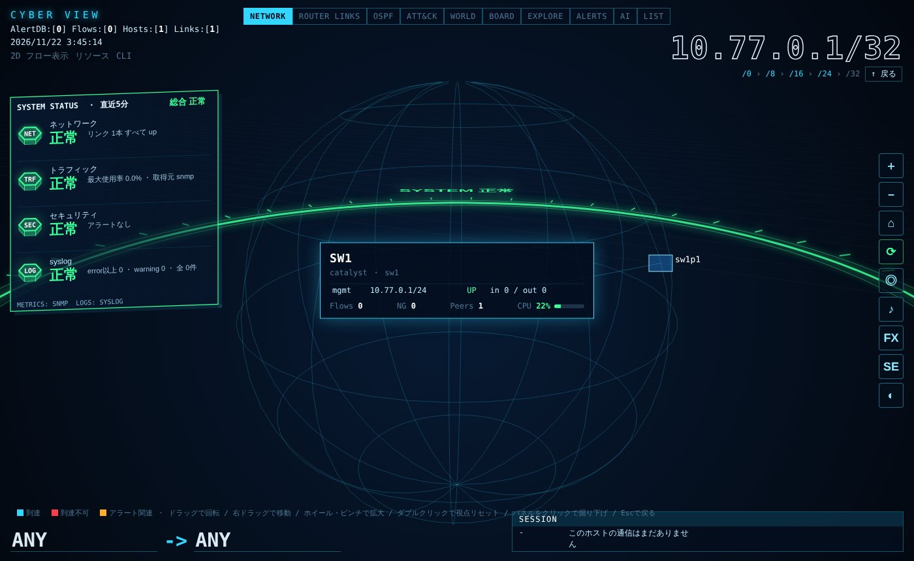

3650 の設定が再起動で消えるとき: パスワードリカバリの後は `SWITCH_IGNORE_STARTUP_CFG="1"` のまま残る(`show romvar | include IGNORE`)。
`no system ignore startupconfig switch all` → `write memory` で `"0"` に戻る(実機で確認)。
- 「停止」で全部止まります。前に手で起動した gnmic・Prometheus があるときは、「手で起動したものを止める」を押します。
- 見るポートとユーザーは「詳しい設定」で変えられます。前回の IP・ポート・ユーザーは覚えますが、パスワードは保存しません。
- 設定画面はこの PC の中(127.0.0.1)からしか開けません。入力した値は確かめてから渡します(IP の形・ポート名の形)。
- 必要なもの: Windows の Python(ニルヴァーナの部品は .bat が初回に入れる)と、WSL の Ubuntu(gnmic を入れるとき sudo のパスワードを聞かれるため、gnmic だけは最初に一度 WSL で入れておくと確実)。

ラボの Catalyst(gNMI 有効)に対して、Linux 上で画面から「開始」→ 約 20 秒で gnmic・Prometheus・ニルヴァーナが動作中になり、ポートの状態が表に出ることを Playwright で確かめました。
設定画面を強制終了して残ったニルヴァーナも、次の「開始」で入れ替わります。Windows の .bat と WSL 経由の呼び出しは、この作業環境では動かせないため、実機の Windows で確かめてください。

## いちばん簡単な方法: `gnmi-quickstart.sh`(Linux / WSL)

装置の設定(下の 1)を済ませたら、WSL では次の 1 行で、gnmic と Prometheus の用意・設定・起動・確認まで終わります。

```bash
cd nirvana-lab/cyber-view-standalone && ./gnmi-quickstart.sh up --target 192.168.1.1 --ports Gi1/0/1
```

- gnmic が無ければ公式の導入スクリプトで入れ、Prometheus は `~/nirvana-gnmi` に取ってきます。
- 設定は 16.x の癖に合わせて書きます(ポートごとの `/state` 購読、`export-timestamps` なし、`expiration` は間隔の 2.5 倍)。パスワードを含む `gnmic.yaml` は本人だけが読めるようにします。
- `nohup` で起動するので、画面を閉じても止まりません。
- 値が Prometheus まで届いたかを確かめ、だめならログから原因の目安(届かない / 認証 / 購読の打ち切り など)を出します。
- ニルヴァーナの設定 `~/nirvana-gnmi/nirvana.yaml` も作ります(つながり `links` は手で足します)。

| コマンド | 何をするか |
|---|---|
| `./gnmi-quickstart.sh up --target <IP>[,<IP>...] --ports <ポート>[,...]` | 用意して起動し、確かめる。ユーザー・パスワードは聞かれる(`--user`・`--password` や `GNMI_PASSWORD` でも渡せる) |
| `./gnmi-quickstart.sh status` | 動いているかと、値が届いているか |
| `./gnmi-quickstart.sh down` | 止める |
| `./gnmi-quickstart.sh config ...` | 設定ファイルだけ書く(起動しない) |

以下は、スクリプトが中でやっていることを手で行う手順です。

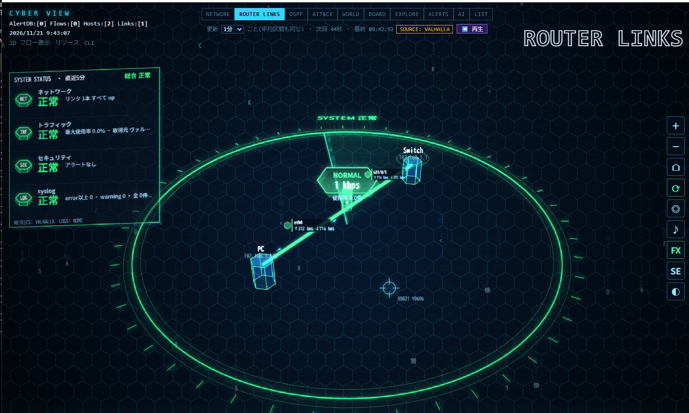

## 1. 装置(Catalyst)の設定

IOS XE 16.x(例: WS-C3650 16.12.11)の場合です。17.x では `gnmi-yang` の代わりに `gnxi` / `gnxi server` を使います。

```
aaa new-model
aaa authentication login default local
aaa authorization exec default local
username admin privilege 15 secret <パスワード>
netconf-yang           ! 16.x では gNMI の土台(DMI)を起こすために必要
gnmi-yang
gnmi-yang server       ! 暗号化なし・ポート 50052
```

`show platform software yang-management process` で `gnmib : Running` になるまで 1〜3 分待ちます。
`show running-config | include gnmi` に `gnmi-yang` と `gnmi-yang server` の 2 行が出ることを確かめます。

## 2. gnmic(Linux / WSL)

gnmic は Linux と Mac 向けだけです。Windows では WSL の Ubuntu で動かします。

```bash
bash -c "$(curl -sL https://get-gnmic.openconfig.net)"
```

`cyber-view-standalone/gnmic.example.yaml` を `gnmic.yaml` にコピーし、`targets` に装置の IP を書きます。

```bash
export GNMI_USER=admin GNMI_PASSWORD='<パスワード>'
nohup gnmic --config gnmic.yaml --log subscribe > gnmic.log 2>&1 &
```

```bash
curl -s http://127.0.0.1:9804/metrics | grep in_octets
```

IOS XE 16.x では、購読するパスにポート名(キー)を必ず書きます。
`/interfaces/interface/state/counters` のようにポート名を省くと、次のエラーで断られます(WS-C3650 16.12.11 で確認)。
17.x とラボはポート名を省いても通ります(全ポート分)。

```
rpc error: code = InvalidArgument desc = Subscription to filter '/oc-if:interfaces/interface/state/counters' ...
has missing keys. All key values must be specified for parent lists
```

また、`oper-status` だけの購読は、少しすると装置に打ち切られます(装置のログに `%MDT_SUBSCRIPTION-4-TERMINATED ... run-time error`、gnmic に `Canceled by operator`)。
ポートの `state` をまとめて購読すれば、`oper-status` もカウンタも 1 本で届きます。メトリクス名は同じ(`..._state_oper_status`・`..._state_counters_in_octets`)です。

監視するポートを 1 つずつ並べたパスは、次のように作れます(例: Gi1/0/1〜24)。

```bash
for i in $(seq 1 24); do echo "      - \"/interfaces/interface[name=GigabitEthernet1/0/$i]/state\""; done
```

`state` をまとめて購読すると、`strings-as-labels` によってカウンタの系列にも `oper_status` や `admin_status` のラベルが付きます。
そのため、ポートの状態が変わるたびに系列が分かれます(古い方も gnmic の `expiration` まで残ります)。
ニルヴァーナは装置・ポートごとに `max by (source, interface_name)` で 1 本にまとめてから `rate` を取るので、分かれ目でも流量は途切れず、2 重にも数えません。

装置の時計も合わせてください(`clock timezone JST 9 0` と `clock set`、本番は `ntp server`)。
`export-timestamps: true` は装置の時刻をそのまま使うので、時計が遅れていると、Prometheus は届いた値を古い値として扱います。

gnmic は `--log` を付けないと、つながらないときのエラーを何も出しません。最初は `gnmic --config gnmic.yaml --log subscribe` で起動してください。
WSL では、Ubuntu の画面を閉じると `&` で起動したプログラムも止まります。`nohup` を付けて起動します。

`prometheus` 出力の `strings-as-labels: true` は外さないでください(oper-status を見るのに使います)。

`export-timestamps: true` は、装置の時計が NTP で正確なときだけ付けます。装置の時刻をそのまま Prometheus に渡すため、時計がずれていると値が捨てられます。
WS-C3650 では、Prometheus の `up` が 1 なのに値が空になりました。付けない場合は `expiration` を短く(25 秒)して、状態が変わったときに古い系列が残る時間を短くします。

- `strings-as-labels: true`: oper-status(文字列)をラベルにします。これが無いと断を判定できません。
- 状態が UP → DOWN に変わると、古い UP の系列も gnmic の `expiration` まで残ります。ニルヴァーナは系列ごとの最新時刻で新しい方を選びます。`export-timestamps` が無いと両方の時刻が同じになるため、`expiration` のあいだは古い方を選ぶことがあります。

## 3. Prometheus

```yaml
scrape_configs:
  - job_name: gnmic
    static_configs: [{targets: ['<gnmic を動かす機械>:9804']}]
```

## 4. ニルヴァーナ

```yaml
devices:
  - id: sw1
    hostname: Switch
    type: catalyst
    mgmt_ip: 192.168.1.1          # gnmic の targets と同じ IP
    interfaces:
      - {name: GigabitEthernet1/0/1, ip: 192.168.1.1, prefix: 24}
sources:
  prometheus:
    url: http://127.0.0.1:9090
    flavor: gnmic                 # SNMP も使うなら both
    gnmic_job: gnmic
```

`install.sh` は Prometheus に gnmic の系列があれば見つけて、`flavor` と `gnmic_job` を書きます。
gnmic は IF の IP を出さないので、リンク(`links`)は手で書きます。

gnmic には装置ごとの `up` が無いので、gnmic だけのときは「応答なし」の判定はしません。

## ライブ確認(2026-11-20)

ラボの Catalyst 2 台(`gnxi server`、10.77.0.1 / 10.77.0.2、Gi1/0/1 同士をリンク)に対して、本物の gnmic と Prometheus 2.54.1 を使い、
`python3 server.py -c <設定> --port 8091` のニルヴァーナで次のとおり確かめました。

| 操作 | gnmic の出力 | ニルヴァーナ(`/api/traffic/links`) |
|---|---|---|
| 起動直後 | `oper_status="UP"` | `POLL: up`・0 bps |
| `ping 10.77.0.2 repeat 2000 size 1500` を流す | `in_octets` が増える | 約 8.1 Mbps ずつ(上の画面写真は約 15.3 Mbps)、`source: prometheus`(ヴァルハラ) |
| GN2 で `shutdown` | `oper_status="DOWN"`(古い UP の系列も残る) | `down: true`・`POLL: down` |
| `no shutdown` | `oper_status="UP"`(古い DOWN の系列も残る) | `down: false`・`POLL: up` |

実機の 3650 と同じ「`state` をまとめて購読」の形でも確かめました。GN2 の `shutdown` → `no shutdown` のあと、ポートごとにまとめない問い合わせでは
GN2 の流量が UP と DOWN の 2 本に分かれました(3.9 Mbps と 1.8 Mbps)。まとめる問い合わせでは 1 本(3.5 Mbps)で、断の判定も復旧後は UP に戻りました。

最初は oper_status の問い合わせで `timestamp(... == 1)` と書いていました。比較の結果には問い合わせ時刻が付くため、新旧の系列を区別できませんでした。
`timestamp(M) and (M == 1)` に直して、断と復旧の両方が正しく切り替わることを確かめています。

実機の WS-C3650-24TD(IOS XE 16.12.11)では、ユーザーが gnmic(WSL)で同じパスの購読ができることを確かめています。
Windows の pygnmi は get は通りましたが、subscribe は `Unsupported subscription list qos selection` で断られました
(pygnmi が付ける QoS の欄を 16.12 が受け付けない)。gnmic は QoS を付けないので通ります。

## 実機で確かめた(2026-11-21、WS-C3650-24TD / IOS XE 16.12.11)

Windows の PC(192.168.1.100)を Gi1/0/1 に直結し、WSL の Ubuntu で gnmic と Prometheus 2.54.1、Windows の Python でニルヴァーナ単体版(`--port 8091`)を動かしました。
ROUTER LINKS に Switch ─ PC のリンクが出て、gNMI のカウンタから送受信の流量(数百 bps)と NORMAL、SYSTEM STATUS「総合 正常」、取得元ヴァルハラが表示されました。

途中でつまずいたことと、その対処です(上の各節に反映済み)。

| 起きたこと | 原因 | 対処 |
|---|---|---|
| `has missing keys` で購読が断られる | 16.x はポート名(キー)の無いパスを受け付けない | `[name=GigabitEthernet1/0/1]` を付ける |
| oper-status の購読が `Canceled by operator`(装置に `%MDT_SUBSCRIPTION-4-TERMINATED`) | 16.12 が値 1 つの購読を打ち切る | `/state` をまとめて購読する |
| Prometheus の `up` は 1 なのに値が空 | `export-timestamps` が装置の時刻(ずれていた)を渡し、Prometheus が捨てた | `export-timestamps` を外し、`expiration: 25s` にする |
| gnmic のログが空 | `--log` が無いと何も出さない | `--log` を付ける |
| 前日の設定が消えた | `write memory` をしていなかった | 設定後に `write memory` |

試験は `tests/test_nirvana_gnmic_source.py` です。
