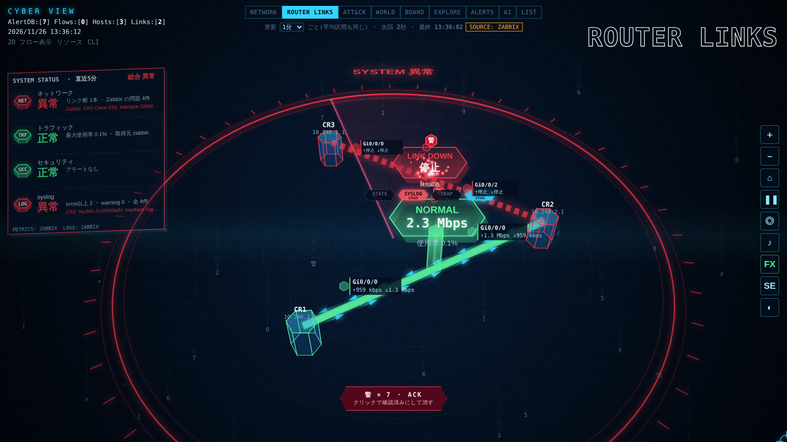

# 既存の Zabbix にニルヴァーナ(サイバービュー)を足す

Zabbix でトラフィックやログを見ている環境に、ニルヴァーナ単体版(`cyber-view-standalone/`)を足して、
同じデータを `/cyber-view` の画面で見る。ニルヴァーナは Zabbix の API を読むだけで、Zabbix の設定は変えない。



## Zabbix から読むもの

| Zabbix | 画面 |
|---|---|
| `Interface …: Bits received / Bits sent`(「Network interfaces by SNMP」系テンプレート) | リンクの流量・使用率 |
| `Interface …: Operational status`、管理者 shutdown で自動検出が無効にしたアイテム | LINK DOWN の検知経路「POLL」 |
| 未解決の問題(problem.get) | 警報(Zabbix: …) |
| ホストの到達性 | 応答なし |
| **ログ型アイテム**(エージェントの `log[]`・`logrt[]`・`eventlog[]`、ログ型の trapper) | ログ一覧・装置の上のログ・LINK DOWN の「SYSLOG」・error 以上の警報・フラップ |
| **SNMP トラップのアイテム**(`snmptrap[...]`・`snmptrap.fallback`) | 同上 |

ログは 2 か所から読む:

- **機器のホストに付いたアイテム**(SNMP トラップ、機器に送った trapper のログ等)→ そのホストの装置のログ。
- **`log_hosts` に書いたホスト**(syslog サーバーにエージェントを入れて、ファイルを `log[]` で読んでいる等)→
  行頭の「時刻 送信元」を外し、送信元・行の中の IP・装置名で装置を決める。設定に無い装置の行は捨てる。

Zabbix は syslog を直接受けないので、ネットワーク機器の syslog は「rsyslog 等で受けてファイルに書き、
そのサーバーのエージェントが `log[]` で読む」形が多い。この形を `log_hosts` で読む。

## 手順

1. **Zabbix で API トークンを作る**(ユーザー → API トークン)。権限は対象のホストグループを読めるだけで足りる。
2. **ニルヴァーナを置いて、インストーラーで下書きを作る**

   ```bash
   cd nirvana-lab/cyber-view-standalone
   ZABBIX_TOKEN=xxxx ./install.sh --zabbix http://<Zabbix>/api_jsonrpc.php --zabbix-group Network
   ```

   - 「Interface …: Bits received」のアイテムがあるホスト(= ネットワーク機器)を装置にする。種類(cisco / nexus /
     juniper …)はテンプレート名から推定する。
   - IF の IP は Zabbix に無いので、SNMP v1/v2c のホストには ipAddrTable を問い合わせて補い、同じ /30・/31 の
     2 台をつながりとして推定する。community は ホストの SNMP インタフェース → ホストのマクロ → グローバル
     マクロ の順に引く。秘密のマクロは API で読めないので `--snmp-community` で渡す。問い合わせたくなければ
     `--no-snmp-probe`(つながりは手で書く)。SNMPv3 のホストは問い合わせない。
   - ログ型アイテムを持つ機器以外のホスト(syslog サーバー等)は `sources.zabbix.log_hosts` に入る。
   - トークンは `config.yaml` に書かれない(`${ZABBIX_TOKEN}` のまま)。チャットやリポジトリに貼らない。
3. **`config.yaml` を見直す**(つながりの過不足、装置の種類)。
4. **起動する**

   ```bash
   ZABBIX_TOKEN=xxxx .venv/bin/python server.py -c config.yaml --port 8090
   ```

   常に動かすなら `./install.sh --service`(systemd)。画面は `http://<このホスト>:8090/`。

## 本物の Zabbix 7.0 での確認(2026-11-26)

構成(すべてこのサンドボックス内):

- Zabbix 7.0.32(server・web・PostgreSQL 16・agent2、docker、host network。Docker Hub が 429 で断ったので
  `mirror.gcr.io` から取得)
- 監視対象: エミュレータの Cisco 3 台 CR1─CR2─CR3(`iac/cisco-traffic-monitoring/lab/provision_cisco_lab.sh` +
  CR3)。Zabbix に「既存の環境」として API で登録: テンプレート `Cisco IOS by SNMP`、community はホストのマクロ
  `{$SNMP_COMMUNITY}`、ホストグループ Network
- syslog: ルータ → `logging host 127.0.0.1 transport udp port 5514` → 小さな受信口(rsyslog の代わり)が
  `/var/log/netlab/network.log` に「時刻 送信元 本文」で書く → ホスト `syslog-srv` のエージェント2 が
  `log[/var/log/netlab/network.log]`(アクティブ、5 秒)で読む
- CR2 には機器のホストのログ型アイテム(trapper `netlab.log`)も作り、zabbix_sender と同じ通信で 1 行送った

インストーラー(Zabbix だけ、トークンは環境変数):

```
Zabbix     : http://127.0.0.1:8080/api_jsonrpc.php (ネットワーク機器 3 台)
装置       : 3 台 CR1(zabbix), CR2(zabbix), CR3(zabbix)
注: Zabbix: IF の流量アイテム(Interface …: Bits received)が無いホスト 2 台は装置に入れていません
注: Zabbix: ログのアイテムがあるホスト syslog-srv を sources.zabbix.log_hosts に入れました(行の中の IP・装置名で装置を決める)
書きました: zbx-config.yaml(装置 3 台・つながり 2 本・取り込み口 zabbix)
```

作られた `config.yaml` には、IF の IP(SNMP で補ったもの、/30 と /24)と、つながり
`cr1 Gi0/0/0 ─ cr2 Gi0/0/0`・`cr2 Gi0/0/2 ─ cr3 Gi0/0/0`、`log_hosts: [syslog-srv]` が入った
(手で書いたものは無い)。

起動して ping を流した状態:

```
CR1 Gi0/0/0 CR2 Gi0/0/0 720024 560024 ok zabbix
{'metrics': 'zabbix', 'logs': 'zabbix'}
```

CR2 の Gi0/0/2(CR3 向け)を shutdown(13:35:15):

```
13:35:26  CR2 Gi0/0/2 CR3 Gi0/0/0 down  evidence SYSLOG=down POLL=up     ← Zabbix のエージェントが読んだ syslog
13:35:55  CR2 Gi0/0/2 CR3 Gi0/0/0 down  evidence SYSLOG=down POLL=down   ← Zabbix の Operational status
警報: link_down          CR2 Gi0/0/2 ⇄ CR3 Gi0/0/0 が down (検知: SYSLOG)
      syslog_error       %LINK-3-UPDOWN: Interface GigabitEthernet0/0/2, changed state to down
      zabbix_problem     Cisco IOS: Interface Gi0/0/2(WAN to CR3): Link down
ログ: CR2 %OSPF-5-ADJCHG: … from FULL to DOWN …   ← CR2 のホストのログ型アイテム(trapper)
```

no shutdown(13:36:21)→ 13:37:53 に up(SYSLOG は即時、POLL は Zabbix の次の SNMP 取得まで)。

### 確認中に直したこと

- syslog サーバーがファイルに書いた行は、先頭に「時刻 送信元」が付き、中継が重なると二重になる
  (`Nov 26 13:32:36 127.0.0.1 Nov 26 13:32:36 CR3 %LINK-3-UPDOWN: …`)。この頭を外してから取り込み、
  外した送信元も装置の特定に使うようにした。
- このラボでは syslog の送信元が 127.0.0.1(lo 上で送るため)になるので、装置は行の中の装置名(CR3)で決まる。
  実機では送信元 IP で決まる。

## 気をつけること

- 流量・POLL の速さは Zabbix の取得間隔(Cisco テンプレートは 1 分)で決まる。syslog(log[])は数秒で届く。
- 落ちたリンクの流量は、Zabbix の最後の値が残って見えることがある(リンクは LINK DOWN として表示される)。
- 管理者が shutdown した IF は、Zabbix のテンプレートが次の自動検出で無効にする。復旧後も次の自動検出
  (既定 1 時間)まで無効のままなので、早く戻したいときは Zabbix で検出ルールを「今すぐ実行」する。
- ログのアイテムの一覧は 5 分ごとに引き直す(新しく作ったアイテムが画面に出るまで最大 5 分)。
- Prometheus と併用すると、流量は Prometheus が優先される。ログは Loki・syslog の直接受信と併用できる。

テスト: `tests/test_nirvana_zabbix_addon.py`(偽の Zabbix API。ログの 3 経路・log_hosts の行頭外し・不要な
テキスト型を読まないこと・logs: false・インストーラーの装置/IF の IP/つながり/community の引き方/グループ/
SNMPv3/秘密のマクロ/トークン無し)。
