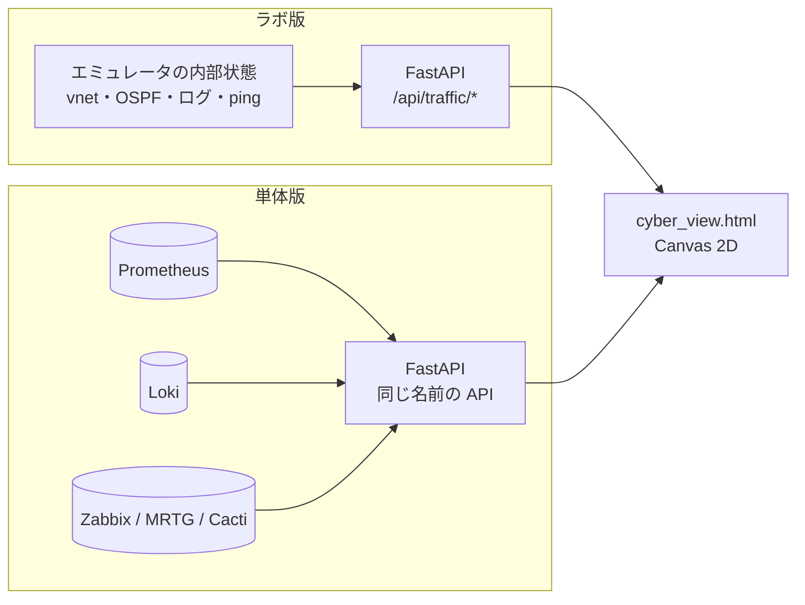

## はじめに

前回の記事「10年前のサイバー攻撃可視化を AI と作り直した『モックニルヴァーナ』でできること・できないこと」では、何ができるかを紹介しました。今回は**中身の作り方**を書きます。

モックニルヴァーナは、NICT の NIRVANA改 の「眺めているだけで状況が分かる」という発想を借りた、ネットワークの可視化画面です。画面上の名前は「CYBER VIEW」です。自作のネットワーク機器エミュレータ(nirvana-lab)の上で動くラボ版と、実機の監視基盤(Prometheus・Loki・Zabbix など)から読む単体版があります。

実装はほぼすべて、Claude Code に日本語で頼んで作りました。この記事では、作ってみて「ここは工夫が要った」と感じた所を中心にまとめます。

## 全体の形: 画面は 1 枚の HTML、データは JSON の API



ポイントは次の2つです。

- **画面は 1 枚の HTML**(`static/cyber_view.html`、約 4,400 行)です。ビルドの仕組みも外部ライブラリも使っていません。監視室のような、外へ出られない端末でも開けるようにするためです。
- **画面は API の JSON しか見ません。** 装置の一覧、リンクの流量、状態ボード、警報などを、`/api/traffic/hosts` や `/api/traffic/links` から読みます。単体版は同じ名前の API を、Prometheus などの値から組み立てて返します。こうしておくと、画面のファイルを 1 つのまま、ラボ版と単体版の両方で使えます。

## 1. three.js を使わずに 3D を描く

3D の部分は、Canvas 2D に自前の透視投影を書いています。中身はこれだけです。

```js
function proj(x, y, z) {
  x -= cam.px; z -= cam.pz;                // パン(視点の中心を床の上でずらす)
  const pt = cam.pitch + cam.bob;
  const cy = Math.cos(cam.yaw), sy = Math.sin(cam.yaw), cp = Math.cos(pt), sp = Math.sin(pt);
  const x1 = x * cy - z * sy, z1 = x * sy + z * cy;        // 縦軸のまわりの回転
  const y2 = y * cp + z1 * sp, z2 = -y * sp + z1 * cp;     // 見下ろす角度
  const d = z2 + cam.dist;
  if (d < 0.5) return null;                                 // カメラの後ろは描かない
  const f = Math.min(W, H * 1.25) * 1.05, s = f / d;
  return { x: W / 2 + x1 * s, y: H * 0.54 - y2 * s, s, d };
}
```

- 回転は 2 回(縦軸のまわりと、見下ろす角度)だけです。
- 戻り値の `s`(遠いほど小さくなる倍率)を、線の太さや文字の大きさにも使います。遠くの装置の文字は小さく描かれます。
- `cam.bob` は、待機中にゆっくり揺らすための値です。何も操作していないと、画面が自動で回って少し揺れます。

立体の形は、この `proj` で点を画面に移してから、Canvas の普通の線と塗りで描いています。サブネットを包むワイヤーフレームの球、装置の柱、リンクの中ほどに立つ六角柱、警報の「警」の六角形などです。

ライブラリを使わなかった良かった点は、**1 ファイルで完結すること**と、**描く物を全部自分で決められること**です。困った点は、重なりの判定や光り方を全部自分で書く必要があることです。次の 2 つの節がその話です。

## 2. 表示の札(プレート)を重ねない

装置の上には、流量・ping の結果・ログなどの札(プレート)を立てます。装置が増えると札どうしが重なり、上のメニューや状態ボードにもかぶります。

そこで、1 フレームごとに「もう札を置いた場所」と「画面の部品がある場所」を集めておき、空いている所を探して置くようにしました。

```js
function placePlate(cx, cy, w, h) {
  const hit = (y) => [...plateBoxes, ...plateBlock].some(b =>
    cx - w / 2 < b.x + b.w && cx + w / 2 > b.x && y - h / 2 < b.y + b.h && y + h / 2 > b.y);
  const step = h + 6;
  // 上へずらす → だめなら下へ。画面の外には置かない(置けなければ描かない)
  for (const dir of [-1, 1]) {
    for (let k = 0; k < 6; k++) {
      const y = cy + dir * k * step;
      if (y - h / 2 < 0 || y + h / 2 > H) break;
      if (!hit(y)) { plateBoxes.push({ x: cx - w / 2, y: y - h / 2, w, h }); return y; }
    }
  }
  return null;
}
```

- 置けなかった札は**描きません**。札が見えないのは困りますが、重なって読めない札が並ぶよりはましだと判断しました。
- 同じ場所・同じ種類のポップアップは「×3」のようにまとめ、1 か所に 3 枚までにしています。

**つまずいた点**: 画面の部品(メニューなど)が表示されているかを `offsetParent` で判定していたところ、どの部品も「表示されていない」扱いになり、札が部品の上に重なっていました。部品が `position: fixed` だと `offsetParent` は常に `null` になるためです。`getClientRects().length` で判定するように直しました。

## 3. 光らせると重い: GPU の無い端末への対策

ネオンのように光る表現には、Canvas の `shadowBlur` を使っています。ただ、これは GPU の無い環境ではとても重くなります。

画面全体をにじませる「発光」の演出は、次の形にしました。

- 画面を **1/4 の大きさに縮めた**ものを作り、`lighter`(加算合成)で重ねる。
- 縮めた画像は **3 フレームに 1 回**だけ作り直す(光り方は数フレームではあまり変わらないため)。
- それでも遅い端末では、**自動で発光を止める**。

```js
function fxPerf(t) {
  const dt = fxPrevT ? Math.min(250, t - fxPrevT) : 16; fxPrevT = t;
  if (!fxBloomOn || document.hidden || dt >= 250) return;   // 裏のタブ・止まっていた後は数えない
  fxFrameEma = fxFrameEma * 0.92 + dt * 0.08;               // 1 フレームの時間をならす
  fxSlowMs = fxFrameEma > 34 ? fxSlowMs + dt : Math.max(0, fxSlowMs - dt * 0.5);
  if (fxSlowMs > 4000) fxBloomOn = false;                   // 遅い状態が合わせて 4 秒続いたら止める
}
```

1 フレームの平均が 34ms(約 29fps)より遅い時間が、合わせて 4 秒たまったら発光だけを止めます。速いフレームが来たら少しずつ差し引くので、一瞬だけ重くなっても止まりません。後から足した演出(レーダー・色ずれなど)では、`shadowBlur` を使わないことにしました。

## 4. 検知: ルールを辞書で持つ

ラボ版の検知は、通信の記録(`engine/traffic_analytics.py`)に、記録するそばからルールを当てています。ルールは辞書で持ちます。

```python
RULES = {
    'scan': {'name': 'ICMPスイープ(スキャン)の疑い', 'severity': 'high',
             'window': 60, 'threshold': 8, 'cooldown': 120,
             'desc': '同じ送信元から短時間に多数の異なる宛先IPへ通信'},
    'unreach_burst': {'name': '到達不可の通信が連続', 'severity': 'medium',
                      'window': 60, 'threshold': 5, 'cooldown': 120, ...},
    'flood': {'name': '大量トラフィック(フラッド)の疑い', 'severity': 'high',
              'window': 10, 'threshold': 30 * 1024 * 1024, 'cooldown': 60, ...},
    ...
}
```

- `window` 秒のあいだに `threshold` を超えたら警報を出し、`cooldown` 秒は同じ警報を出しません。
- しきい値を画面やテストから見られるので、「なぜ鳴ったか」を説明しやすくなります。

警報は**検知元**ごとに、花びらとして表示します(IDS・FW・SYSLOG・NET・LOOP・DARKNET・WORLD・AI など)。たとえば ASA の `threat-detection` がスキャン元を締め出したときは、締め出しを判定した部分が記録係に知らせ、FW の花びらとして出します。

## 5. リンク断を 4 つの経路で確かめる

リンクが落ちたことの知り方は、1 つではありません。

| 経路 | 何を見るか |
|---|---|
| STATE | エミュレータ内部の IF の状態(ラボ版だけ) |
| SYSLOG | `%LINK-3-UPDOWN` などのログ(Loki、または内部の記録) |
| TRAP | linkDown / linkUp の SNMP trap |
| POLL | Prometheus から読んだ `ifOperStatus` |

実際の監視では、ログは届いたのに trap は届かない、ポーリングの間隔のせいでまだ気づいていない、といったずれがよく起きます。そこで、経路ごとに「**その IF について最後に見た状態**」を覚えておき、**どれか 1 つでも down なら断**としました。画面では、どの経路が断を示しているかをチップで並べます。


```python
seen = {}            # (経路, 装置, IF 名) -> (時刻, 状態)

def note(src, dev, ifn, t, st):
    if dev in nodes and ifn:
        k = (src, dev, norm_if(ifn))
        if k not in seen or t >= seen[k][0]:
            seen[k] = (t, st)
```

ここで効いてくるのが `norm_if` です。同じポートでも、ログには `GigabitEthernet1/0/1`、trap には `Gi1/0/1`、Prometheus のラベルには別の書き方で出てきます。IF 名を一つの形にそろえないと、同じポートが別物として扱われます。

**踏んだバグ**: ログの重複を除く処理で、「同じ内容の行は 1 回だけ数える」としていました。すると、IF を素早く down → up → down → up とさせたとき、最後の up が「前と同じ行」として捨てられ、リンクが断のまま残りました。**間に同じ IF の逆の変化が挟まっていれば、同じ行でも残す**ように直しました。

SNMP にまったく応答しなくなった装置は、断とは別の「NO RESPONSE(消失)」として灰色で点滅させます。Prometheus の `up{job="..."}` が 0 の装置です。「リンクが落ちた」のか「装置ごと見えなくなった」のかを、画面で区別できるようにしています。

## 6. 単体版: 同じファイルを使い、ずれはテストで見つける

単体版(`cyber-view-standalone/`)は、実機の監視基盤から読むための独立したプログラムです。ラボ版と共通の部品があります。

- 画面: `cyber_view.html`
- 判定の部品: リンク断の判定、フラップの判定、攻撃の対応づけ、ダークネットなど

単体版はエミュレータ本体を import せずに動かしたかったので、共通の部品は**ファイルごとコピー**しています。そのかわり、コピーがずれたらテストで分かるようにしました。

```python
def test_shared_files_are_in_sync_with_the_lab():
    assert filecmp.cmp(os.path.join(ROOT, 'static', 'cyber_view.html'),
                       os.path.join(SA, 'web', 'cyber_view.html'), shallow=False)
    for f in ('flap_rules.py', 'link_evidence.py', 'attack_map.py', 'darknet.py', ...):
        assert filecmp.cmp(os.path.join(ROOT, 'engine', f), os.path.join(SA, 'cvs', f), shallow=False)
```

ラボ側を直したのに単体版へのコピーを忘れると、ここで落ちます。パッケージにして共有する方法もありますが、1 人(と AI)で回すにはこのほうが軽いと判断しました。

単体版がデータを読む先は、Prometheus → Zabbix → MRTG / Cacti の順に試します。古い監視しかない現場でも使えるようにするためです。

### gNMI の値を Prometheus 経由で読むときの小技

gNMI の値は、gnmic が Prometheus 形式で出し、それを Prometheus に貯めて読みます。このとき、IF の状態(`oper_status`)は**ラベル**として出てきます。そのため状態が変わると、古い系列(たとえば `oper_status="UP"`)がしばらく残り、新しい系列(`"DOWN"`)と並んでしまいます。

そこで「同じ IF の系列のうち、いちばん新しく値が入ったもの」を選ぶ式にしました。

```promql
topk by (source, interface_name) (1, timestamp(M) and (M == 1))
```

`timestamp(M == 1)` と書くと、比較の結果に「問い合わせた時刻」が付いてしまい、どの系列も同じ時刻になって区別できません。`timestamp(M) and (M == 1)` の順に書くのがこつでした。

## 7. テストしやすくする工夫

画面は Canvas なので、普通の HTML のように中身を調べられません。そこで、テスト(Playwright)から状態を読むための小さな窓口を、画面に付けています。

```js
window.__cvParticles = () => particles.filter(p => performance.now() >= p.born).length;  // 流れている粒の数
window.__cvPanel = (n) => { /* n 番目のパネルの集計を返す */ };
window.__cvFx = (on) => { /* 演出の ON/OFF と、火の粉・雨の数を返す */ };
```

「ping を打ったら粒が流れるか」「演出を切ったら粒が消えるか」を、画像を見比べずに数で確かめられます。

もう 1 つは、**時間を外から渡せるようにする**ことです。L2 ループの検知のように「1 秒ごとに見回る」処理は、実時間で待つとテストが遅く、不安定になります。そこで見回りの関数が時刻を引数で受け取れるようにして、テストからは「3 秒後の見回り」を直接呼んでいます。

ほかにも、ニルヴァーナまわりのテストは 24 ファイルあります。それでも、本物のツールを当てて初めて見つかるバグが多くありました。たとえば次のようなものです。

- MRTG の cfgmaker を当てたら、半分の装置が「応答なし」になった(SNMP の request-id が負の数のとき、エミュレータが応答を作れなかった)。
- 全体テストのときだけ L2 ループのテストが落ちた。別のテストが起動した裏の見回りが、先に警報を出していたため。

## 8. AI と作ってみて

この画面の機能のほとんどは、スマホから「〜も欲しい」と日本語で頼み、Claude Code が実装・確認・記録までしたものです。作るのは速い一方で、**確かめるほうが大変**でした。

- 見た目は、Playwright でスクリーンショットを撮って、AI 自身が画像を見て直します。それでも、人が見て初めて気づく違和感(文字の重なり、色の意味のずれ)は残ります。
- 「動いているように見える」ことと「本当に正しい」ことは別です。本物のツール(snmp_exporter、MRTG、nmap、Batfish など)を当てる確認を、決まりごとにしました。

## 試し方

```bash
git clone https://github.com/w-index-m/nirvana-lab
cd nirvana-lab
pip install -r requirements.txt
NETLAB_AUTH_DISABLE=1 python app.py
# → http://localhost:8000/cyber-view (DEMO ボタンで障害のシナリオが流れます)
```

## まとめ

- 画面は 1 枚の HTML で、Canvas 2D に自前の透視投影を書きました。データは JSON の API からだけ読むので、ラボ版と単体版で同じ画面を使えます。
- 重なり・重さ・判定のずれといった「地味な所」に、いちばん手がかかりました。
- リンク断は 4 つの経路の「最後に見た状態」を並べ、どれか 1 つでも down なら断としています。
- 共通の部品はファイルごとコピーし、ずれはテストで見つけます。
- AI と作ると速く作れます。だからこそ、確かめる仕組み(テストと本物のツール)を先に用意しておくのが大事でした。

実際に打ったコマンドと結果の記録は、リポジトリの `docs/` にあります(`docs/cyber-view-3d.md`、`docs/cyber-view-standalone.md` など)。
